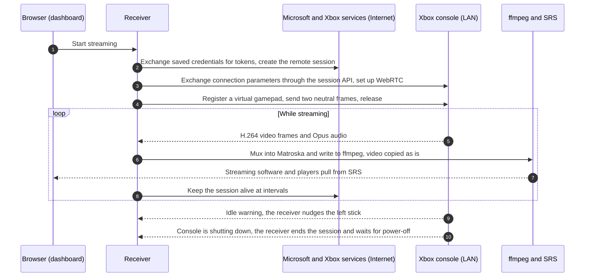

# XSX-Live: Xbox Series X/S native LAN capture and streaming hub

[](LICENSE)
[](docker-compose.yml)
[](receiver)
[](../../actions/workflows/build.yml)

**English** | [简体中文](README.md)

> **Very low overhead, zero video transcoding, native 2K 60fps.** An Xbox LAN WebRTC receiver and streaming hub.
> Built for OBS, the Douyin Live Companion and LAN stream distribution.

---

## 🌟 Highlights

* **🚀 Video is not transcoded (stream copy)**: H.264 video frames are taken from the Xbox WebRTC media stream and remuxed as is, **without decoding or re-encoding, so no quality loss**. No GPU is needed. Only the audio is converted from Opus to AAC.
* **⚡ Very lightweight**: the receiver is written in Rust (on the `str0m` WebRTC stack) and the media server is SRS 5. About 10 MB of memory at idle. While streaming, the load depends on the machine. The figures given by the original project are about 40 MB of memory and 15% of one CPU core.
* **🎛️ Web dashboard**: start and stop streaming, reconnect, watch live frame rate and bitrate, and open a muted preview (port `8099` by default).
* **🎬 Several playback protocols**: HTTP-FLV, RTMP, and a low-latency browser player page with a bundled `mpegts.js`.
* **🔒 LAN-only media**: sign-in, session setup and small heartbeats go over the Internet. Audio and video travel directly between the console and the receiver on the LAN, with no public relay.
* **🎮 Leaves the controller alone**: the receiver sends no gamepad data in normal operation, so playing with a physical controller on the console is unaffected. It only acts right after connecting ("says hello", so the session is not ended for having no client) and when nobody has touched the controller for a long time and the console is about to end the session.
* **🔐 Sign in from the dashboard**: no scripts and no hand-edited credential files.
* **📦 Ready to run**: the data directory is created on first start. Streaming stops when the console shuts down, and you can choose whether it starts again on the next power-on.
* **🌐 Chinese and English UI**: the dashboard and the player page are available in both languages, and the dashboard can switch at any time.

---

## 📐 Architecture

The service is two containers orchestrated by one `docker-compose.yml`:

| Container | Contents | Role |
| :--- | :--- | :--- |
| `xsx-receiver` | Receiver (Rust) + ffmpeg | Signs in to Microsoft, sets up the remote session with the Xbox, receives audio and video and pushes them to the media server. Also serves the dashboard. |
| `xsx-media` | SRS 5 | Takes the RTMP publish and serves HTTP-FLV, RTMP and the browser player page. |

```mermaid
flowchart LR
    MS[Microsoft sign-in and Xbox services<br/>Internet]
    subgraph LAN[LAN]
        X[Xbox Series X / S<br/>WebRTC server: H.264 video + Opus audio]
        subgraph HOST[Machine running this service]
            R[xsx-receiver<br/>receiver + dashboard :8099]
            F[ffmpeg<br/>video passthrough, audio to AAC]
            S[xsx-media (SRS 5)<br/>RTMP :1935, HTTP-FLV :8888]
        end
        C[OBS / Live Companion / browser player]
    end
    U[Browser] -->|opens the dashboard| R
    R -->|sign-in, session setup, connection parameters, keep-alive| MS
    R <-->|UDP / SRTP, media stays on the LAN| X
    R -->|Matroska through a pipe| F
    F -->|RTMP publish| S
    S --> C
```

### How it works



The key points:

* **Little goes over the Internet**: only sign-in, session setup and small heartbeats while streaming (keeping the session alive, checking the console's power state). The dashboard signs in to the Microsoft account with an authorization code and PKCE. The long-lived credentials are stored in `xsx-files/auth/session.json` and renewed by the receiver. Sessions are set up through the Xbox remote play API (xHome): the receiver creates the session through it and exchanges the WebRTC connection parameters (ICE, SDP) with the console. Once the connection is up, picture and sound travel directly between the console and the receiver on the LAN, with no public relay. That keeps latency low and uses no Internet bandwidth.
* **Video is not transcoded**: the receiver wraps the incoming H.264 frames into Matroska and hands them to ffmpeg, which writes them into RTMP with `-c:v copy`, without decoding or re-encoding, so no graphics card is needed. Only the audio is converted from Opus to AAC, because streaming software generally accepts AAC only.
* **The controller is left alone**: the receiver sends no gamepad data. It only acts in two situations: it "says hello" right after connecting, so the session is not ended for having no client, and it nudges the left stick when nobody has touched the controller for about 10 minutes and the console is about to end the session. Details below under "Controller and keep-alive".
* **Streaming stops by itself when the console shuts down**: the console tells the receiver, the receiver ends the session and waits for the console to power off, without reconnecting to it. Whether streaming starts again on the next power-on is decided by the "Start streaming when the console turns on" switch in the dashboard.
* **Distribution**: SRS serves the published stream in three ways at once (HTTP-FLV, RTMP and the browser player page), so streaming software and browsers can each pick one.

The receiver is split into modules by responsibility (`receiver/src/`):

| Module | Responsibility |
| :--- | :--- |
| `main.rs` | Main loop: set up sessions and receive media according to the switch, retry on errors, handle keep-alive and console shutdown |
| `auth.rs`, `login.rs` | Storing and renewing credentials; signing in from the dashboard |
| `xhome.rs` | Calls to the remote play API: sign in, find the console, create the session, exchange connection parameters, keep-alive |
| `rtc/` | Control messages on the WebRTC data channel, and encoding of gamepad input |
| `relay.rs` | Wraps audio and video into Matroska for ffmpeg |
| `dashboard.rs` | Dashboard and API, including the origin check |
| `control.rs` | Saving the streaming switch and "start on power-on" |
| `health.rs`, `logging.rs`, `assets.rs` | Status file, log file, installing the player page files |

---

## 🚀 Quick start

Make sure of three things first:

* You have an Xbox Series X|S on the **same LAN** as the machine running this service. The console has to be turned on by itself. The receiver never wakes it.
* You have a Microsoft account, the one that is signed in on the console.
* Docker and Docker Compose are installed on the machine, and it can reach Microsoft's sign-in and services (it needs Internet access).

There are three ways to install. They only differ in where the receiver image comes from. **On a NAS, or if you do not want to compile anything, pick option A.** From step 2 on, all three are identical.

### Step 1: get the receiver image

#### Option A: import a ready-made image archive (recommended for NAS)

1. Download the archive from the [Releases](../../releases) page of the repository. The file is named like `xsx-live-receiver-v1.0.0.tar.gz`. Decompress it to get the `.tar`.
2. Import the image. In a NAS UI such as Container Station, use the import function on the "Images" page. On the command line it is `docker load -i xsx-live-receiver-v1.0.0.tar`. The image is named `xsx-live/receiver:latest`, which is exactly the name `docker-compose.yml` uses by default.
3. Download [`docker-compose.yml`](docker-compose.yml) from the repository. Building locally is not used in a NAS UI, so delete the three lines that start with `build:` before going on.

#### Option B: pull from a registry

1. Download [`docker-compose.yml`](docker-compose.yml) from the repository and delete the three lines that start with `build:`.
2. Point the image at GitHub's registry. On the command line, set `XSX_IMAGE=ghcr.io/<account>/xsx-live-receiver:<version>` in `.env` (copied from [`.env.example`](.env.example)). In a NAS UI, change the default value on the `image:` line of `docker-compose.yml` to that address.
3. Pull it with `docker compose pull`. In a NAS UI the pull happens when the application is created.

`ghcr.io` is GitHub's own image registry. Every new release is published there automatically. Image packages are private by default. The repository owner has to make the package public on the GitHub Packages page first (once public, it cannot be made private again) before others can pull it.

#### Option C: build locally

For when you want to change the code. Click "Code" on the repository page to copy the clone URL, then:

```bash
git clone <clone URL>
cd xsx-live
cp .env.example .env
```

When you run `docker compose up -d` later, the receiver is compiled automatically. The first time takes a few minutes.

### Step 2: change two addresses

All settings in [`docker-compose.yml`](docker-compose.yml) have defaults. Usually you only need to check these two:

| Setting | Change it to | Why |
| :--- | :--- | :--- |
| `XBOX_IP` | LAN IP of the Xbox console | The receiver exchanges audio and video with this address only, so streaming cannot work if it is wrong. Give the console a static IP. |
| `MEDIA_HTTP_BASE` | `http://<YOUR_HOST_IP>:8888` | The dashboard builds the player and stream addresses from it. If it stays `127.0.0.1`, those addresses are wrong for other devices that open the dashboard. |

How to change them depends on how you install:

* **Command line**: change the two values in `.env`. `docker-compose.yml` can stay as it is.
* **NAS UI**: edit `docker-compose.yml` directly. Replace `192.168.1.180` on the `XBOX_IP` line with the console's IP, and replace `127.0.0.1` on the `MEDIA_HTTP_BASE` line with this machine's IP.

To change ports or the time zone, or to adjust other behavior, see "Environment variables" below.

### Step 3: start

* **NAS UI** (Container Station): create a new application and paste the contents of `docker-compose.yml`. Before pasting, replace both occurrences of `./xsx-files` with an absolute path (for example `/share/ContainerStation/xsx-live/xsx-files`), so the data does not depend on where the compose file lives. Then create and start it.
* **Command line**: run `docker compose up -d` in the directory holding `docker-compose.yml` and `.env`.

### Step 4: sign in and start streaming

Open `http://<YOUR_HOST_IP>:8099/` in a browser, sign in under "Xbox account" (see "Sign in to the Xbox account" below), then click **Start streaming**.

### After it starts

* No files need to be prepared beforehand: the data directory `xsx-files/` is created on first start. See "Data directory" below for what is inside.
* The dashboard and the player page are inside the image. No extra files are needed.
* Check the running state:

```bash
docker compose ps
docker compose logs -f receiver
```

* The log is also written to `xsx-files/state/receiver.log`, one line per entry with local time.
* For moving to a new version later, see "Updating" below.

---

## 🔐 Sign in to the Xbox account

Xbox remote play needs authorization from a Microsoft account. Open the dashboard, click **Sign in** in the Xbox account panel, and sign in **with the account that is signed in on the console**, then consent.

The browser is then taken to `http://localhost/?code=...` and shows "This site can't be reached". That is expected: copy the complete URL from the address bar, paste it back into the dashboard and click **Finish sign-in**.

The credentials are stored in `xsx-files/auth/session.json` and renewed by the receiver. You only sign in again when they have expired. Click **Start streaming** to connect to the console.

A few notes:

* Finish within **10 minutes** of clicking **Sign in**. If it times out, go back to the dashboard and start again.
* While valid credentials exist, the dashboard does not allow signing in again. This stops other devices on the LAN from replacing the credentials you are using.
* By default the Microsoft app registered by the open source project kite is used, so there is nothing to configure. To use your own Microsoft app, see `XBOX_CLIENT_ID` under "Environment variables".

---

## 🏗 Automatic builds

The repository has a GitHub Actions workflow (`.github/workflows/build.yml`). Push a tag starting with `v`, or run the workflow manually from the Actions page with a version number, and GitHub runs the tests, builds the image and publishes it:

* Image: `ghcr.io/<account>/xsx-live-receiver:<version>` and `:latest`
* A compressed image archive `xsx-live-receiver-<version>.tar.gz` (attached to the Release for a tag, a build artifact for a manual run). Decompress it before importing.

Build status and the artifacts of each run are on the [Actions](../../actions/workflows/build.yml) page. Tests run first: the unit tests and two end-to-end tests with a real ffmpeg must pass before the image is built. A tag that does not match the version in `receiver/Cargo.toml` fails immediately.

## 🏷 Version numbers

The version lives in `receiver/Cargo.toml` and is compiled into the program. To publish a release:

1. Change `version` in `receiver/Cargo.toml` (for example to `1.1.0`).
2. Commit, then create and push a tag with the same name: `git tag v1.1.0 && git push origin v1.1.0`.
3. GitHub Actions checks that the tag and `version` match, and only then builds and publishes the image and the image archive.

Where to see which version is running:

* The dashboard footer ("receiver vX.Y.Z". "Too old to report a version" means the image has not been replaced yet).
* The `version` field of `GET /api/status`.
* The first line of the log `xsx-files/state/receiver.log`: `VERSION version=…`.
* `docker exec xsx-receiver /usr/local/bin/xsx-native --version`.
* The image label `org.opencontainers.image.version`.

---

## 🖥️ Dashboard and usage

Open the dashboard in a browser:
`http://<YOUR_HOST_IP>:8099/`

* **Start streaming**: connect to an Xbox that is turned on, receive the picture and push it to the media server.
* **Stop streaming**: end the current session, stop the local publish and pause automatic reconnects.
* **Reconnect XSX**: restart the session quickly, without restarting the whole service.
* **Live monitoring**: resolution (up to 2560×1440), frame rate, bitrate and streaming time.
* **Preview**: open a low-latency muted preview on demand.
* **Xbox account**: sign in to the Microsoft account. Signing in is not allowed while valid credentials exist, so other devices on the LAN cannot replace them.
* **Start streaming when the console turns on**: streaming stops when the console shuts down. When this is on, it starts again on the next power-on; when off, tap **Start streaming** yourself.
* **Language**: switch between "中文" and "EN" at the top right of the page. See "Languages" below.

The dashboard only accepts access by IP (for example `http://192.168.1.10:8099/`). Access by hostname returns 403. This prevents another site from pointing its own domain at this machine and impersonating the dashboard.

> Controller and keep-alive: the receiver sends no gamepad data in normal operation. During the handshake after power-on it "says hello" to the console once (registers a virtual gamepad, sends two neutral input frames and releases immediately) so the session is not ended for having no client. After about 10 minutes without controller input the console warns about being idle and disconnects 120 seconds later. At that point the receiver nudges the left stick to 12.5% and recenters it after 40 ms (the same thing the official Microsoft web client does), and nudges again half a minute later as a safety net. Each nudge shows "<gamertag> is remote playing" on the console screen. Set `IDLE_KEEPALIVE` to `0` to turn this off, at the cost of being disconnected after a long idle period.

---

## 🌐 Languages

The dashboard and the player page are available in Chinese and English.

* **Dashboard**: switch between "中文" and "EN" at the top right of the page. The language is decided in this order: `?lang=en` or `?lang=zh` in the URL (for example `http://<YOUR_HOST_IP>:8099/?lang=en`), the language last picked in this browser, then the browser's own language (anything other than Chinese gets English). API errors carry a fixed code, and the page translates the code into the current language.
* **Player page**: follows the browser language. `?lang=` can force it, and the dashboard passes its current language when it opens the player page.
* **Sign-in redirect page**: follows the browser language.

To add a third language, change the three text tables: `dashboard/i18n.js` (dashboard), `TEXT` in `www/index.html` (player page) and `TEXTS` in `receiver/src/dashboard.rs` (API errors and the redirect page). The unit tests check that every text key used by the page and the scripts has an entry in both languages.

---

## 📺 OBS and Live Companion

Add a source in **Douyin Live Companion** or **OBS Studio**:

1. **Option 1: browser source (recommended)**
   * URL: `http://<YOUR_HOST_IP>:8888/xsx/index.html`
   * Resolution: `1920x1080` or `2560x1440` (16:9)
   * Enable "Control audio via OBS" (or the equivalent) to capture game audio. The player page starts muted. To start with sound, add `?audio=1` to the URL.
2. **Option 2: media source / HTTP-FLV**
   * URL: `http://<YOUR_HOST_IP>:8888/live/xsx.flv`
3. **Option 3: RTMP pull**
   * URL: `rtmp://<YOUR_HOST_IP>:1935/live/xsx`

---

## ⚙️ Environment variables

Usually only the two entries marked ★ need changing. Everything else has a working default. The `SRS_*` variables of the media server are low-latency tuning and normally stay as they are. The meaning of each one is written in the comments of [`docker-compose.yml`](docker-compose.yml).

| Variable | Default | Description |
| :--- | :--- | :--- |
| ★ `XBOX_IP` | `192.168.1.180` | LAN IP of the Xbox console. **Must be correct.** The receiver exchanges audio and video with this address only, so give the console a static IP. |
| `BIND_IP` | `0.0.0.0` | Address the SRS ports bind to on the host |
| `DASHBOARD_BIND` | `0.0.0.0:8099` | Listen address of the dashboard. With `0.0.0.0` the page can be opened through any IP of the machine. |
| ★ `MEDIA_HTTP_BASE` | `http://127.0.0.1:8888` | Address other devices use to reach the media server. The dashboard builds the player and stream addresses from it. Set it to the LAN IP of this machine. |
| `OUTPUT_RTMP` | `rtmp://127.0.0.1:1935/live/xsx` | RTMP target that the receiver publishes to |
| `XBOX_AUTH_FILE` | `/files/auth/session.json` | Credential file inside the container |
| `STATE_DIR` | `/files/state` | Directory for state and control files inside the container. The log `receiver.log` is written here too. |
| `WWW_DIR` | `/files/www` | Output directory of the player page, written on start. Leave unset to skip. |
| `DASHBOARD_DIR` | unset | When set, the dashboard is read from this directory, so pages can be edited without recompiling. |
| `TZ` | `Asia/Shanghai` | Time zone used in the log |
| `IDLE_KEEPALIVE` | `1` | Whether to nudge the stick after an idle warning. `0` turns it off. |
| `XBOX_CLIENT_ID` | built in | Microsoft app ID used by the dashboard sign-in. Unset uses the built-in one, which comes from the open source project kite. |
| `AUTH_REDIRECT_URI` | unset | Redirect address after sign-in. Must start with `https://` and be registered in the app. Unset uses the paste-the-URL sign-in. |
| `XBOX_SERVER_ID` | unset | When the account owns several consoles, the one to stream from |
| `XSX_IMAGE` | `xsx-live/receiver:latest` | Receiver image. See `.env.example` for using the image published on GitHub. |

---

## 📁 Data directory

`xsx-files/` is created on first start. All three ways of installing use the same directory:

```text
xsx-files/
├── auth/
│   └── session.json       Microsoft account credentials. Created by signing in on the dashboard, renewed by the receiver. Keep it private
├── state/
│   ├── control.json       Current state of the streaming switch and "start on power-on"
│   ├── status.json        Current state of the receiver, read by the dashboard
│   ├── receiver.log       Receiver log. Rotated to receiver.previous.log when it passes 20MB
│   └── ffmpeg.log         Output of ffmpeg. Appears once a session has been set up
└── www/                   Player page (index.html and its library). Written on start and read by the media server
```

For a backup or a migration, `auth/` and `state/control.json` are enough: the first saves you from signing in again, the second keeps your switch settings. Everything else is regenerated.

---

## 🔄 Updating

All data lives in `xsx-files/`. Moving to a new version does not touch it, so the sign-in and the switch settings are kept.

1. Get the new image: download and import the new image archive from Releases, or run `docker compose pull`.
2. Recreate the application: in Container Station, use "Rebuild" on the application. On the command line, run `docker compose up -d` in the directory holding the compose file.
3. Open the dashboard. The footer showing the new version number means it worked. "Too old to report a version" means the old image is still in use.

To go back to an old version, import that version's image archive and recreate again. The data directory stays as it is.

---

## ❓ FAQ

* **The dashboard returns 403**: The dashboard only accepts access by IP, for example `http://192.168.1.10:8099/`, and the port has to match `DASHBOARD_BIND`. Access by hostname, or with the wrong port, returns 403.

* **The status stays on "Waiting for XSX to turn on"**: The receiver never wakes the console. Turn the console on and it connects by itself. The matching reason in the log is `CONSOLE_OFFLINE`.

* **After signing in, the browser shows "This site can't be reached"**: That is expected. When the Microsoft sign-in is done, the browser is taken to `http://localhost/?code=...` on your own machine. Copy the complete URL from the address bar, paste it into the dashboard and click **Finish sign-in**.

* **"The sign-in has expired" or "Sign-in verification failed"**: Finish within 10 minutes of clicking **Sign in**, and use the redirect URL that belongs to that sign-in. Go back to the dashboard and start again.

* **A newly opened player page takes two or three seconds to show a picture**: The media server turns off keyframe caching to keep latency low, so a new viewer waits for the next keyframe. To show a picture immediately (at the cost of higher latency), set `SRS_VHOST_PLAY_GOP_CACHE` to `on` in `docker-compose.yml`.

* **The player page has no sound**: The player page starts muted. Move the mouse or a finger and tap "Sound" in the bottom-right corner. To make a browser source in streaming software start with sound, add `?audio=1` to the address.

* **Streaming dropped after a long time without touching the controller**: By default it does not: when the console warns about idleness, the receiver nudges the stick to keep the session. With `IDLE_KEEPALIVE` set to `0`, the console ends the session after about 12 minutes without controller input. That is a rule of the console.

* **Streaming dropped in the middle**: The receiver reconnects by itself. Nothing to do. The log is in `xsx-files/state/receiver.log`, one line per entry with the time. A `VIDEO_SPS_CHANGED` line means the console changed its encoding parameters and the receiver kept writing. It is not a fault.

* **Streaming stopped when the console shut down**: This is intended: when the console shuts down, the receiver ends the session and leaves the console alone while it powers off. Whether streaming starts again on the next power-on is decided by the "Start streaming when the console turns on" switch in the dashboard.

* **How do I tell which version is running?**: Look at the dashboard footer, or at the first line of the log, `VERSION version=…`. See "Version numbers" above.

---

## 🗂 Repository layout

```text
.
├── receiver/              Receiver (Rust)
│   ├── Cargo.toml         The version number lives here
│   ├── Dockerfile         Build file used by GitHub Actions and by local builds
│   └── src/               Source code. Each module's job is described under "Architecture"
├── dashboard/             Static files of the dashboard: index.html, app.js, i18n.js, style.css
├── www/                   Player page: index.html and the mpegts.js it uses
├── docker-compose.yml     Example configuration, with a comment on every setting
├── .env.example           Example environment variables
├── srs.conf               Reference configuration of the media server, equivalent to the SRS_* variables in the compose file
└── .github/workflows/     GitHub Actions: tests, building the image, publishing
```

---

## 🛡️ Security notes

This service is designed for a **trusted LAN**. There are no accounts or passwords:

* **The dashboard has no password**: any device on the LAN can open it and start or stop streaming. The dashboard only accepts access by IP, which stops impersonation by other websites, not people on the LAN.
* **Streaming in and out has no authentication**: any device on the LAN can watch the stream, and while the receiver is not publishing, other devices can publish to the same stream name.
* **Credentials**: `auth/session.json` under `xsx-files/` holds your Microsoft account credentials. **Never commit it to a public repository or share it with anyone.** `.gitignore` and `.dockerignore` exclude the whole directory.

Use it on a trusted LAN only, and **do not expose ports 8099, 8888 or 1935 to the Internet**.

---

## 📄 License

This project is licensed under the MIT license. The full text is in [LICENSE](LICENSE) at the root of the repository (the same text as `receiver/LICENSE.upstream`, which ships with the receiver code). The protocol reverse engineering and signaling implementation build on excellent community projects such as `DRHATL95/kite` and `unknownskl/xbox-xcloud-player`. Many thanks to their authors. The `mpegts.js` library used by the player page is MIT licensed too and distributed with its license (`www/vendor/LICENSE`).
