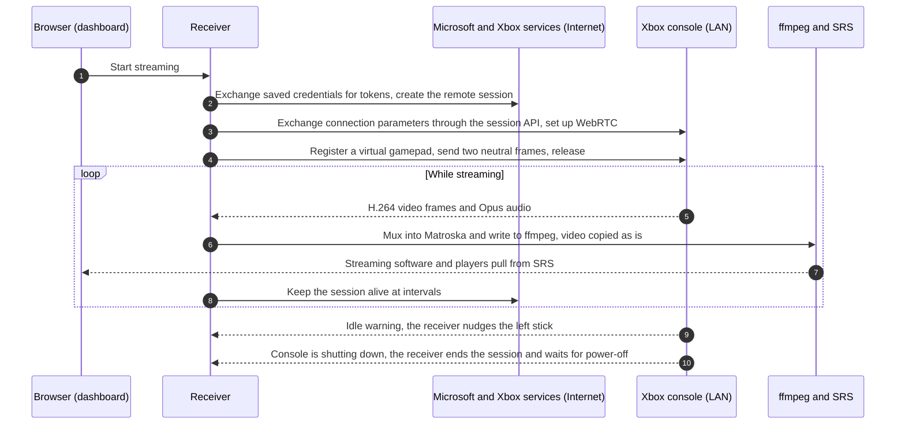

# XSX-Live: Xbox Series X/S native LAN capture and streaming hub

[](LICENSE)
[](docker-compose.yml)
[](receiver)
[](../../actions/workflows/build.yml)

**English** | [简体中文](README.md)

> **Very low overhead, zero video transcoding, native 2K 60fps.** An Xbox LAN WebRTC receiver and streaming hub.
> Built for OBS, the Douyin Live Companion and LAN stream distribution.

**About**: receives the picture and sound of an Xbox Series X|S on a NAS or PC in the LAN and turns them into a live stream. Streaming software such as OBS or the Douyin Live Companion can take that stream, and browsers can watch it directly. Audio and video only travel on the LAN, so playing on the console with a controller is unaffected.

---

## 🌟 Highlights

* **🚀 Zero video transcoding (stream copy)**: the H.264 video frames from the Xbox are remuxed as is, without decoding or re-encoding. **No quality loss and no GPU needed.** Only the audio is converted from Opus to AAC.
* **⚡ Lightweight**: the receiver is written in Rust (on the `str0m` WebRTC stack) and the media server is SRS 5. About 10 MB of memory at idle. While streaming, the load depends on the machine. The reference figures given by the original project are about 40 MB of memory and 15% of one CPU core.
* **🎛️ Web dashboard**: start and stop streaming, reconnect, live frame rate and bitrate, muted preview. Address in the example configurations: `http://<YOUR_HOST_IP>:31099/`.
* **🎬 Several ways to pull the stream**: HTTP-FLV, RTMP, and a browser player page with a bundled `mpegts.js`.
* **🔒 Audio and video stay on the LAN**: only sign-in, session setup and heartbeats use the Internet. Audio and video travel directly between the console and the receiver, with no public relay.
* **🎮 Leaves the controller alone**: the receiver sends no gamepad data in normal operation, so the physical controller is unaffected. It only registers a virtual gamepad once when connecting, and nudges the stick when there has been no input for a long time and the console is about to end the session.
* **🔐 Sign in from the dashboard**: no scripts and no hand-edited credential files.
* **📦 Ready to run**: the data directory is created automatically. Streaming stops when the console shuts down, and you choose whether it starts again on the next power-on.
* **🌐 Chinese and English UI**: the dashboard and the player page are available in both languages, and the dashboard can switch at any time.

---

## 📖 Terms

The following terms are used throughout this document:

| Term | Meaning |
| :--- | :--- |
| Image | A read-only package holding a program together with its runtime. Import it and it runs. The receiver image is `xsx-live/receiver` |
| Container | A running instance of an image. This service has two containers: the receiver `xsx-receiver` and the media server `xsx-media` |
| Compose file | A YAML file describing which containers to start and how each is configured: the general `docker-compose.yml`, or the ready-made files per NAS brand in [`compose/`](compose) |
| Receiver | The program that connects to the Xbox, receives audio and video and publishes it to the media server. It also serves the dashboard |
| Media server | The service that takes the published stream and offers it to streaming software and the player page. It uses SRS |
| Dashboard | The web page for starting and stopping streaming, signing in and checking the status. Address in the example configurations: `http://<YOUR_HOST_IP>:31099/` |
| Player page | The web page for watching the picture in a browser. Address in the example configurations: `http://<YOUR_HOST_IP>:31888/xsx/index.html` |
| Publish / pull | Publishing is sending out an audio and video stream. Pulling is receiving it. The receiver publishes. Streaming software and the player page pull |
| RTMP / HTTP-FLV | Two streaming transport protocols. Streaming software usually supports at least one of them |
| Transcoding / remuxing | Transcoding encodes the picture again. It costs CPU and can lose quality. Remuxing only changes the container format and does not encode again |
| Environment variable | A setting passed to a program. They are listed under `environment:` in the compose file, and every one has a comment there |
| Data directory | The directory holding the credentials, the running state and the player page, created automatically. `xsx-files/` next to the compose file with the general one, and fixed to `/share/ContainerStation/xsx-live/xsx-files` with the NAS one |
| Credentials | The long-lived token saved after signing in. Stored in `xsx-files/auth/session.json` and renewed by the receiver |
| Registry | The service where images are stored. `ghcr.io` is run by GitHub, Docker Hub by Docker |
| Release | The release page on GitHub. One per version, with the importable image archive attached |

`<YOUR_HOST_IP>` in the addresses means the LAN IP of the machine running this service.

---

## 📐 Architecture

The service is two containers orchestrated by one compose file:

| Container | Contents | Role |
| :--- | :--- | :--- |
| `xsx-receiver` | Receiver (Rust) + ffmpeg | Signs in to Microsoft, sets up the remote session with the Xbox, receives audio and video and pushes them to the media server. Also serves the dashboard. |
| `xsx-media` | SRS 5 | Takes the RTMP publish and serves HTTP-FLV, RTMP and the browser player page. |

```mermaid
flowchart LR
    MS[Microsoft sign-in and Xbox services<br/>Internet]
    subgraph LAN[LAN]
        X[Xbox Series X / S<br/>WebRTC server: H.264 video + Opus audio]
        subgraph HOST[Machine running this service]
            R[xsx-receiver<br/>receiver + dashboard :31099]
            F[ffmpeg<br/>video passthrough, audio to AAC]
            S[xsx-media (SRS 5)<br/>RTMP :31935, HTTP-FLV :31888]
        end
        C[OBS / Live Companion / browser player]
    end
    U[Browser] -->|opens the dashboard| R
    R -->|sign-in, session setup, connection parameters, keep-alive| MS
    R <-->|UDP / SRTP, media stays on the LAN| X
    R -->|Matroska through a pipe| F
    F -->|RTMP publish| S
    S --> C
```

### How it works



The key points:

* **Little goes over the Internet**: only sign-in, session setup and small heartbeats while streaming (keeping the session alive, checking the console's power state). The dashboard signs in to the Microsoft account with OAuth authorization code and PKCE, with the password entered only on Microsoft's page. The long-lived credentials are stored in `xsx-files/auth/session.json` and renewed by the receiver. Sessions are set up through the Xbox remote play API (xHome): the receiver creates the session through it and exchanges the WebRTC connection parameters (ICE and SDP, the addresses and parameters needed to connect directly) with the console. Once the connection is up, picture and sound travel directly between the console and the receiver on the LAN, with no public relay. That keeps latency low and uses no Internet bandwidth.
* **Video is not transcoded**: the receiver wraps the incoming H.264 frames into Matroska and hands them to ffmpeg, which writes them into RTMP with `-c:v copy`, without decoding or re-encoding, so no graphics card is needed. Only the audio is converted from Opus to AAC, because streaming software generally accepts AAC only.
* **The controller is left alone**: the receiver sends no gamepad data. It only acts in two situations: it "says hello" right after connecting, so the session is not ended for having no client, and it nudges the left stick when nobody has touched the controller for about 10 minutes and the console is about to end the session. Details below under "Controller and keep-alive".
* **Streaming stops by itself when the console shuts down**: the console tells the receiver, the receiver ends the session and waits for the console to power off, without reconnecting to it. Whether streaming starts again on the next power-on is decided by the "Start streaming when the console turns on" switch in the dashboard.
* **Distribution**: SRS serves the published stream in three ways at once (HTTP-FLV, RTMP and the browser player page), so streaming software and browsers can each pick one.

The receiver is split into modules by responsibility (`receiver/src/`):

| Module | Responsibility |
| :--- | :--- |
| `main.rs` | Main loop: set up sessions and receive media according to the switch, retry on errors, handle keep-alive and console shutdown |
| `auth.rs`, `login.rs` | Storing and renewing credentials; signing in from the dashboard |
| `xhome.rs` | Calls to the remote play API: sign in, find the console, create the session, exchange connection parameters, keep-alive |
| `rtc/` | Control messages on the WebRTC data channel, and encoding of gamepad input |
| `relay.rs` | Wraps audio and video into Matroska for ffmpeg |
| `dashboard.rs` | Dashboard and API, including the origin check |
| `control.rs` | Saving the streaming switch and "start on power-on" |
| `health.rs`, `logging.rs`, `assets.rs` | Status file, log file, installing the player page files |

---

## 🚀 Quick start

Before you start:

* An Xbox Series X|S on the **same LAN** as the machine running this service, and turned on (the receiver never wakes the console).
* A Microsoft account, the one that is signed in on the console.
* Docker and Docker Compose installed on the machine (the NAS container suite already includes them), with access to Microsoft's sign-in and services.

The [`compose/`](compose) directory holds ready-made compose files per NAS brand. Copy one, change the places marked `TODO`, and paste it into the container manager of your NAS. The three ways to install only differ in where the receiver image comes from.

### Option A: import the image archive (recommended for NAS)

1. **Download the archive** from [Releases](../../releases): `xsx-live-receiver-v1.0.1.tar.gz`. Decompress it to get the `.tar`.
2. **Import the image and create the application**, depending on your NAS brand:
   * **QNAP (Container Station)**: copy [`compose/qnap.yml`](compose/qnap.yml). On "Images", click "Import" and pick the `.tar`. Change the place marked `TODO` in the file (only the console address). On "Applications", click "Create", paste the file, then create and start.
   * **Synology (Container Manager, DSM 7.2 and above)**: copy [`compose/synology.yml`](compose/synology.yml). On "Image", click "Add" and choose "Add from file", then pick the `.tar`. On "Project", click "Create", choose a folder for the data, pick "Create docker-compose.yml", paste the edited file, and go through the wizard to the end.
3. **Sign in and start**. Open `http://<IP of the NAS>:31099/` in a browser, sign in under "Xbox account" (see "Sign in to the Xbox account" below), then click **Start streaming**.

### Option B: pull from a registry

No downloading or importing an archive. The NAS only needs access to `ghcr.io`, the registry run by GitHub. Every version is published there automatically, and the image is pulled when the application is created.

1. Copy the pull variant for your brand: [`compose/qnap-pull.yml`](compose/qnap-pull.yml) for QNAP, [`compose/synology-pull.yml`](compose/synology-pull.yml) for Synology.
2. Change the place marked `TODO` (only the console address). The image address is already filled in and points to the image this repository publishes on ghcr.io.
3. Create the application as in option A for your brand (skip the image import).

Image packages are private by default. The repository owner has to make the package public on the GitHub Packages page first (once public, it cannot be made private again) before others can pull it.

### Option C: build locally

For when you need to change the code. Click "Code" on the repository page to copy the clone URL:

```bash
git clone <clone URL>
cd xsx-live
cp .env.example .env
```

When you run `docker compose up -d`, the receiver is compiled automatically. The first time takes a few minutes. Settings go into `.env`; see "Configuration" below.

### Configuration

In the NAS files, usually only the place marked `TODO` needs changing:

| Setting | Change it to | Why |
| :--- | :--- | :--- |
| `XBOX_IP` | LAN IP of the Xbox console | It can be left unset: the receiver then takes the console address from the candidates Microsoft pushes during connection (`XBOX_IP` wins when set). When set, it must be correct. Give the console a static IP. |

The rest have working defaults. Two worth knowing about:

* `MEDIA_HTTP_BASE`: the default `http://127.0.0.1:31888` works as is (since 1.0.1). The dashboard generates the player and stream addresses from the IP you open it with. Keep the port in line with the media HTTP port (31888 in the example configurations).
* Ports, the time zone and the other options are described under "Environment variables" below, and every one also has a comment in the compose file.

### After it starts

* No files need to be prepared beforehand: the data directory is created on first start. See "Data directory" below for what is inside.
* The dashboard and the player page are inside the image.
* Check the running state:

```bash
docker compose ps
docker compose logs -f receiver
```

* The log is also written to `state/receiver.log` in the data directory, one line per entry with local time.
* For moving to a new version, see "Updating" below.

---

## 🔐 Sign in to the Xbox account

Xbox remote play needs authorization from a Microsoft account. Open the dashboard, click **Sign in** in the Xbox account panel, and sign in **with the account that is signed in on the console**, then consent.

The browser is then taken to `http://localhost/?code=...` and shows "This site can't be reached". That is expected: copy the complete URL from the address bar, paste it back into the dashboard and click **Finish sign-in**.

The credentials are stored in `xsx-files/auth/session.json` and renewed by the receiver. You only sign in again when they have expired. Click **Start streaming** to connect to the console.

A few notes:

* Finish within **10 minutes** of clicking **Sign in**. If it times out, go back to the dashboard and start again.
* While valid credentials exist, the dashboard does not allow signing in again. This stops other devices on the LAN from replacing the credentials you are using.
* By default the Microsoft app registered by the open source project kite is used, so there is nothing to configure. To use your own Microsoft app, see `XBOX_CLIENT_ID` under "Environment variables".

---

## 🏗 Automatic builds

The repository has a GitHub Actions workflow (`.github/workflows/build.yml`). Push a tag starting with `v`, or run the workflow manually from the Actions page with a version number, and GitHub runs the tests, builds the image and publishes it on its own servers:

* Image: `ghcr.io/hizml/xsx-live-receiver:<version>` and `:latest`
* A compressed image archive `xsx-live-receiver-<version>.tar.gz` (attached to the Release for a tag, a build artifact for a manual run). Decompress it before importing.
* The media server image: the official SRS image copied to `ghcr.io/hizml/xsx-live-media:5` by pinned digest (the official one is on Docker Hub, often unreachable in mainland China).

Build status and the artifacts of each run are on the [Actions](../../actions/workflows/build.yml) page. Tests run first: the unit tests and two end-to-end tests with a real ffmpeg must pass before the image is built. A tag that does not match the version in `receiver/Cargo.toml` fails immediately.

## 🏷 Version numbers

The version lives in `receiver/Cargo.toml` and is compiled into the program. To publish a release:

1. Change `version` in `receiver/Cargo.toml` (for example to `1.1.0`).
2. Commit, then create and push a tag with the same name: `git tag v1.1.0 && git push origin v1.1.0`.
3. GitHub Actions checks that the tag and `version` match, and only then builds and publishes the image and the image archive.

Where to see which version is running:

* The dashboard footer ("receiver vX.Y.Z". "Too old to report a version" means the image has not been replaced yet).
* The `version` field of `GET /api/status`.
* The first line of the log `xsx-files/state/receiver.log`: `VERSION version=…`.
* `docker exec xsx-receiver /usr/local/bin/xsx-native --version`.
* The image label `org.opencontainers.image.version`.

---

## 🖥️ Dashboard and usage

Open the dashboard in a browser:
`http://<YOUR_HOST_IP>:31099/`

* **Start streaming**: connect to an Xbox that is turned on, receive the picture and push it to the media server.
* **Stop streaming**: end the current session, stop the local publish and pause automatic reconnects.
* **Reconnect XSX**: restart the session quickly, without restarting the whole service.
* **Live monitoring**: resolution (up to 2560×1440), frame rate, bitrate and streaming time.
* **Preview**: open a low-latency muted preview on demand.
* **Xbox account**: sign in to the Microsoft account. Signing in is not allowed while valid credentials exist, so other devices on the LAN cannot replace them.
* **Start streaming when the console turns on**: streaming stops when the console shuts down. When this is on, it starts again on the next power-on; when off, tap **Start streaming** yourself.
* **Language**: switch between "中文" and "EN" at the top right of the page. See "Languages" below.

The dashboard accepts access by IP plus port, or by `localhost` plus port, for example `http://192.168.1.10:31099/`; on the machine itself, `http://localhost:31099/` or `http://127.0.0.1:31099/` works. Other hostnames return 403. This defends against DNS rebinding: a site on the public Internet can point its own domain at your LAN IP and let your browser reach the dashboard and its API on its behalf. `localhost` is always resolved to the machine itself by the browser, so an attacker cannot control it, and it is allowed.

> Controller and keep-alive: the receiver sends no gamepad data in normal operation. During the handshake after power-on it "says hello" to the console once (registers a virtual gamepad, sends two neutral input frames and releases immediately) so the session is not ended for having no client. After about 10 minutes without controller input the console warns about being idle and disconnects 120 seconds later. At that point the receiver nudges the left stick to 12.5% and recenters it after 40 ms (the same thing the official Microsoft web client does). While idle, the virtual gamepad stays registered — one registration per idle period and one nudge per warning round — so the "<gamertag> is remote playing" toast appears once at the start instead of every round; when a round stops arriving (usually because someone came back to play), the virtual gamepad is released. Each nudge shows "<gamertag> is remote playing" on the console screen. Set `IDLE_KEEPALIVE` to `0` to turn this off, at the cost of being disconnected after a long idle period.

---

## 🌐 Languages

The dashboard and the player page are available in Chinese and English.

* **Dashboard**: switch between "中文" and "EN" at the top right of the page. The language is decided in this order: `?lang=en` or `?lang=zh` in the URL (for example `http://<YOUR_HOST_IP>:31099/?lang=en`), the language last picked in this browser, then the browser's own language (anything other than Chinese gets English). API errors carry a fixed code, and the page translates the code into the current language.
* **Player page**: follows the browser language. `?lang=` can force it, and the dashboard passes its current language when it opens the player page.
* **Sign-in redirect page**: follows the browser language.

To add a third language, change the three text tables: `dashboard/i18n.js` (dashboard), `TEXT` in `www/index.html` (player page) and `TEXTS` in `receiver/src/dashboard.rs` (API errors and the redirect page). The unit tests check that every text key used by the page and the scripts has an entry in both languages.

---

## 📺 OBS and Live Companion

Add a source in **Douyin Live Companion** or **OBS Studio**:

1. **Option 1: browser source (recommended)**
   * URL: `http://<YOUR_HOST_IP>:31888/xsx/index.html`
   * Resolution: `1920x1080` or `2560x1440` (16:9)
   * Enable "Control audio via OBS" (or the equivalent) to capture game audio. The player page starts muted. To start with sound, add `?audio=1` to the URL.
2. **Option 2: media source / HTTP-FLV**
   * URL: `http://<YOUR_HOST_IP>:31888/live/xsx.flv`
3. **Option 3: RTMP pull**
   * URL: `rtmp://<YOUR_HOST_IP>:31935/live/xsx`

---

## ⚙️ Environment variables

Usually only the entry marked ★ needs changing. Everything else has a working default. The `SRS_*` variables of the media server are low-latency tuning and normally stay as they are. The meaning of each one is written in the comments of [`docker-compose.yml`](docker-compose.yml).

| Variable | Default | Description |
| :--- | :--- | :--- |
| ★ `XBOX_IP` | `192.168.1.180` | LAN IP of the Xbox console. When set, it must be correct; give the console a static IP. It can also be left unset: the receiver takes the console address from the candidates Microsoft pushes during connection. |
| `BIND_IP` | `0.0.0.0` | Address the SRS ports bind to on the host |
| `DASHBOARD_BIND` | `0.0.0.0:31099` | Listen address of the dashboard. With `0.0.0.0` the page can be opened through any IP of the machine. |
| `MEDIA_HTTP_BASE` | `http://127.0.0.1:31888` | Address other devices use to reach the media server. The default works as is (since 1.0.1): the dashboard generates the player and stream addresses from the IP you open it with. Keep the port in line with the media HTTP port (31888 in the example configurations). |
| `OUTPUT_RTMP` | `rtmp://127.0.0.1:31935/live/xsx` | RTMP target that the receiver publishes to |
| `XBOX_AUTH_FILE` | `/files/auth/session.json` | Credential file inside the container |
| `STATE_DIR` | `/files/state` | Directory for state and control files inside the container. The log `receiver.log` is written here too. |
| `WWW_DIR` | `/files/www` | Output directory of the player page, written on start. Leave unset to skip. |
| `DASHBOARD_DIR` | unset | When set, the dashboard is read from this directory, so pages can be edited without recompiling. |
| `TZ` | `Asia/Shanghai` | Time zone used in the log |
| `IDLE_KEEPALIVE` | `1` | Whether to nudge the stick after an idle warning. `0` turns it off. |
| `XBOX_CLIENT_ID` | built in | Microsoft app ID used by the dashboard sign-in. Unset uses the built-in one, which comes from the open source project kite. |
| `AUTH_REDIRECT_URI` | unset | Redirect address after sign-in. Must start with `https://` and be registered in the app. Unset uses the paste-the-URL sign-in. |
| `XBOX_SERVER_ID` | unset | When the account owns several consoles, the one to stream from |
| `XSX_IMAGE` | `xsx-live/receiver:latest` | Receiver image. To use the image published on GitHub, set it to `ghcr.io/hizml/xsx-live-receiver:<version>` and run `docker compose pull`. |

---

## 📁 Data directory

`xsx-files/` is created on first start. All three ways of installing use the same directory:

```text
xsx-files/
├── auth/
│   └── session.json       Microsoft account credentials. Created by signing in on the dashboard, renewed by the receiver. Keep it private
├── state/
│   ├── control.json       Current state of the streaming switch and "start on power-on"
│   ├── status.json        Current state of the receiver, read by the dashboard
│   ├── receiver.log       Receiver log. Rotated to receiver.previous.log when it passes 20MB
│   └── ffmpeg.log         Output of ffmpeg. Appears once a session has been set up
└── www/                   Player page (index.html and its library). Written on start and read by the media server
```

For a backup or a migration, `auth/` and `state/control.json` are enough: the first saves you from signing in again, the second keeps your switch settings. Everything else is regenerated.

---

## 🔄 Updating

All data lives in `xsx-files/`. Moving to a new version does not touch it, so the sign-in and the switch settings are kept.

1. Get the new image. The pull-variant compose files (`*-pull.yml`) carry `pull_policy: always`, so recreating the application pulls the new version by itself. On the command line, run `docker compose pull`. With the imported-archive method, note that "Rebuild" on a NAS does **not** pick up a newly imported image with the same name by default: delete the old `xsx-live/receiver` on the "Images" page first, then import the new one and rebuild.
2. Recreate the application: use "Rebuild" on it in Container Station (or edit and apply again). On the command line, run `docker compose up -d` in the directory holding the compose file.
3. Open the dashboard. The footer showing the new version number means it worked. "Too old to report a version" means the old image is still in use.

To go back to an old version, import that version's image archive and recreate again. The data directory stays as it is.

---

## ❓ FAQ

* **The dashboard returns 403**: The dashboard only accepts access by IP or `localhost`, for example `http://192.168.1.10:31099/`, and the port has to match `DASHBOARD_BIND`. Other hostnames are rejected, as is a mismatched port. Access by hostname, or with the wrong port, returns 403.

* **The status stays on "Waiting for XSX to turn on"**: The receiver never wakes the console. Turn the console on and it connects by itself. The matching reason in the log is `CONSOLE_OFFLINE`.

* **After signing in, the browser shows "This site can't be reached"**: That is expected. When the Microsoft sign-in is done, the browser is taken to `http://localhost/?code=...` on your own machine. Copy the complete URL from the address bar, paste it into the dashboard and click **Finish sign-in**.

* **"The sign-in has expired" or "Sign-in verification failed"**: Finish within 10 minutes of clicking **Sign in**, and use the redirect URL that belongs to that sign-in. Go back to the dashboard and start again.

* **A newly opened player page takes two or three seconds to show a picture**: The media server turns off keyframe caching to keep latency low, so a new viewer waits for the next keyframe. To show a picture immediately (at the cost of higher latency), set `SRS_VHOST_PLAY_GOP_CACHE` to `on` in `docker-compose.yml`.

* **The player page has no sound**: The player page starts muted. Move the mouse or a finger and tap "Sound" in the bottom-right corner. To make a browser source in streaming software start with sound, add `?audio=1` to the address.

* **Streaming dropped after a long time without touching the controller**: By default it does not: when the console warns about idleness, the receiver nudges the stick to keep the session. With `IDLE_KEEPALIVE` set to `0`, the console ends the session after about 12 minutes without controller input. That is a rule of the console.

* **Streaming dropped in the middle**: The receiver reconnects by itself. Nothing to do. The log is in `xsx-files/state/receiver.log`, one line per entry with the time. A `VIDEO_SPS_CHANGED` line means the console changed its encoding parameters and the receiver kept writing. It is not a fault.

* **Streaming stopped when the console shut down**: This is intended: when the console shuts down, the receiver ends the session and leaves the console alone while it powers off. Whether streaming starts again on the next power-on is decided by the "Start streaming when the console turns on" switch in the dashboard.

* **The media image cannot be pulled when creating the application**: the compose files use the copy in this repository's ghcr (`ghcr.io/hizml/xsx-live-media:5`) by default, so Docker Hub is not needed. To use the official address instead, change `image:` back to `ossrs/srs:5` (on Docker Hub; configure a registry mirror if it is unreachable).
* **How do I tell which version is running?**: Look at the dashboard footer, or at the first line of the log, `VERSION version=…`. See "Version numbers" above.

---

## 🗂 Repository layout

```text
.
├── receiver/              Receiver (Rust)
│   ├── Cargo.toml         The version number lives here
│   ├── Dockerfile         Build file used by GitHub Actions and by local builds
│   └── src/               Source code. Each module's job is described under "Architecture"
├── dashboard/             Static files of the dashboard: index.html, app.js, i18n.js, style.css
├── www/                   Player page: index.html and the mpegts.js it uses
├── docker-compose.yml     General example configuration (for local builds), with a comment on every setting
├── compose/                Ready-made configurations for NAS, four files by brand and install way. Only the places marked TODO need changing
├── .env.example           Example environment variables
├── srs.conf               Reference configuration of the media server, equivalent to the SRS_* variables in the compose file
└── .github/workflows/     GitHub Actions: tests, building the image, publishing
```

---

## 🛡️ Security notes

This service is designed for a **trusted LAN**. There are no accounts or passwords:

* **The dashboard has no password**: any device on the LAN can open it and start or stop streaming. The dashboard only accepts access by IP, which stops impersonation by other websites, not people on the LAN.
* **Streaming in and out has no authentication**: any device on the LAN can watch the stream, and while the receiver is not publishing, other devices can publish to the same stream name.
* **Credentials**: `auth/session.json` under `xsx-files/` holds your Microsoft account credentials. **Never commit it to a public repository or share it with anyone.** `.gitignore` and `.dockerignore` exclude the whole directory.

Use it on a trusted LAN only, and **do not expose ports 31099, 31888 or 31935 to the Internet**.

---

## 📄 License

This project is licensed under the MIT license. The full text is in [LICENSE](LICENSE) at the root of the repository (the same text as `receiver/LICENSE.upstream`, which ships with the receiver code). The protocol reverse engineering and signaling implementation build on excellent community projects such as `DRHATL95/kite` and `unknownskl/xbox-xcloud-player`. Many thanks to their authors. The `mpegts.js` library used by the player page is MIT licensed too and distributed with its license (`www/vendor/LICENSE`). The media server SRS is MIT licensed as well; the copy in ghcr is the official image reproduced by digest.
