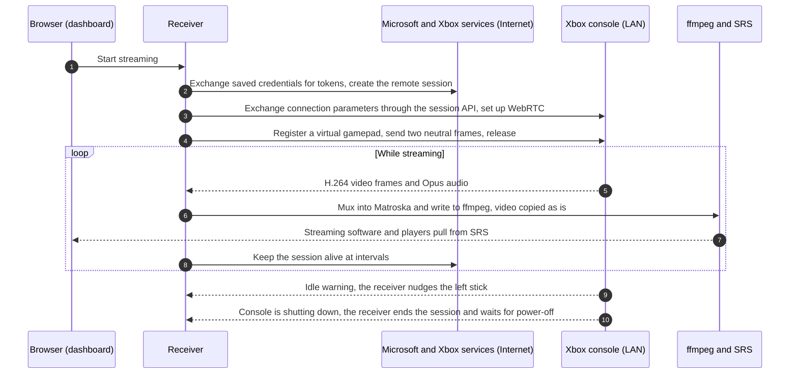

# XSX-Live: Xbox Series X/S native LAN capture and streaming hub

[](LICENSE)
[](docker-compose.yml)
[](receiver)
[](../../actions/workflows/build.yml)

**English** | [简体中文](README.md)

> **Very low overhead, zero video transcoding, native 2K 60fps.** An Xbox LAN WebRTC receiver and streaming hub.
> Built for OBS, the Douyin Live Companion and LAN stream distribution.

---

## 🌟 Highlights

* **🚀 Native video passthrough (stream copy)**: H.264 video frames are extracted from the Xbox WebRTC media stream and remuxed without decoding or re-encoding. **No quality loss, no GPU or hardware encoder needed.**
* **⚡ Very lightweight**: the receiver is written in Rust (on the `str0m` WebRTC stack) and the media server is C++ (`SRS 5`). Around **20 MB** of memory at idle, **~40 MB** while streaming, about 15% of one CPU core.
* **🎛️ Web dashboard**: start and stop streaming, reconnect, watch live frame rate and bitrate, and open a muted preview (port `8099` by default).
* **🎬 Several playback protocols**: HTTP-FLV, RTMP, and a low-latency browser player page with a bundled `mpegts.js`.
* **🔒 LAN-only media**: the Microsoft APIs are used only for sign-in and session setup. Audio and video stay on the LAN, with no public STUN/TURN relay.
* **🎮 Leaves the controller alone**: the receiver sends no gamepad data in normal operation, so playing with a physical controller on the console is unaffected. It only nudges the stick when nobody has touched the controller for a long time and the console is about to end the session.
* **🔐 Sign in from the dashboard**: no scripts and no hand-edited credential files.
* **📦 Ready to run**: the data directory is created on first start. Streaming stops when the console shuts down, and you can choose whether it starts again on the next power-on.
* **🌐 Chinese and English UI**: the dashboard and the player page are available in both languages, and the dashboard can switch at any time.

---

## 📐 Architecture

The service is two containers orchestrated by one `docker-compose.yml`:

| Container | Contents | Role |
| :--- | :--- | :--- |
| `xsx-receiver` | Receiver (Rust) + ffmpeg | Signs in to Microsoft, sets up the remote session with the Xbox, receives audio and video and pushes them to the media server. Also serves the dashboard. |
| `xsx-media` | SRS 5 | Takes the RTMP publish and serves HTTP-FLV, RTMP and the browser player page. |

```mermaid
flowchart LR
    MS[Microsoft sign-in and Xbox services<br/>Internet]
    subgraph LAN[LAN]
        X[Xbox Series X / S<br/>WebRTC server: H.264 video + Opus audio]
        subgraph HOST[Machine running this service]
            R[xsx-receiver<br/>receiver + dashboard :8099]
            F[ffmpeg<br/>video passthrough, audio to AAC]
            S[xsx-media (SRS 5)<br/>RTMP :1935, HTTP-FLV :8888]
        end
        C[OBS / Live Companion / browser player]
    end
    U[Browser] -->|opens the dashboard| R
    R -->|sign-in, session setup, connection parameters, keep-alive| MS
    R <-->|UDP / SRTP, media stays on the LAN| X
    R -->|Matroska through a pipe| F
    F -->|RTMP publish| S
    S --> C
```

### How it works



The key points:

* **Little goes over the Internet**: only sign-in, session setup and small heartbeats while streaming (keeping the session alive, checking the console's power state). The dashboard signs in to the Microsoft account with an authorization code and PKCE. The long-lived credentials are stored in `xsx-files/auth/session.json` and renewed by the receiver. Sessions are set up through the Xbox remote play API (xHome): the receiver creates the session through it and exchanges the WebRTC connection parameters (ICE, SDP) with the console. Once the connection is up, picture and sound travel directly between the console and the receiver on the LAN, with no public relay. That keeps latency low and uses no Internet bandwidth.
* **Video is not transcoded**: the receiver wraps the incoming H.264 frames into Matroska and hands them to ffmpeg, which writes them into RTMP with `-c:v copy`, without decoding or re-encoding, so no graphics card is needed. Only the audio is converted from Opus to AAC, because streaming software generally accepts AAC only.
* **The controller is left alone**: the receiver sends no gamepad data. It only acts in two situations: it "says hello" right after connecting, so the session is not ended for having no client, and it nudges the left stick when nobody has touched the controller for about 10 minutes and the console is about to end the session. Details below under "Controller and keep-alive".
* **Streaming stops by itself when the console shuts down**: the console tells the receiver, the receiver ends the session and waits for the console to power off, without reconnecting to it. Whether streaming starts again on the next power-on is decided by the "Start streaming when the console turns on" switch in the dashboard.
* **Distribution**: SRS serves the published stream in three ways at once (HTTP-FLV, RTMP and the browser player page), so streaming software and browsers can each pick one.

The receiver is split into modules by responsibility (`receiver/src/`):

| Module | Responsibility |
| :--- | :--- |
| `main.rs` | Main loop: set up sessions and receive media according to the switch, retry on errors, handle keep-alive and console shutdown |
| `auth.rs`, `login.rs` | Storing and renewing credentials; signing in from the dashboard |
| `xhome.rs` | Calls to the remote play API: sign in, find the console, create the session, exchange connection parameters, keep-alive |
| `rtc/` | Control messages on the WebRTC data channel, and encoding of gamepad input |
| `relay.rs` | Wraps audio and video into Matroska for ffmpeg |
| `dashboard.rs` | Dashboard and API, including the origin check |
| `control.rs` | Saving the streaming switch and "start on power-on" |
| `health.rs`, `logging.rs`, `assets.rs` | Status file, log file, installing the player page files |

---

## 🚀 Quick start

### 1. Clone the repository and prepare the environment

Make sure `docker` and `docker compose` are installed:

```bash
git clone https://github.com/<YOUR_USER>/xsx-live.git
cd xsx-live
```

Copy the configuration file:

```bash
cp .env.example .env
```

Edit `.env` with the LAN IP of your Xbox and the IP of the machine running the service (replace `<YOUR_HOST_IP>` with that machine's IP):

```ini
# LAN static IP of the Xbox Series X / S
XBOX_IP=192.168.1.180

# Bind IP on the host (0.0.0.0 for LAN access)
BIND_IP=0.0.0.0

# Dashboard listen address
DASHBOARD_BIND=0.0.0.0:8099

# Base HTTP URL that clients use for playback
MEDIA_HTTP_BASE=http://<YOUR_HOST_IP>:8888

# RTMP target
OUTPUT_RTMP=rtmp://127.0.0.1:1935/live/xsx
```

---

### 2. Start the service

Docker Compose is the recommended way to install. The example configuration is [`docker-compose.yml`](docker-compose.yml) in this repository, and addresses and ports are changed in `.env`. No files need to be prepared beforehand: the data directory `xsx-files/` (credentials, runtime state, player page) is created on first start, and the dashboard and player page are baked into the image.

All three ways of installing use the same `docker-compose.yml`:

| Situation | What to do |
| :--- | :--- |
| Build locally | `docker compose up -d`. The first run compiles the receiver, which takes a few minutes. |
| Import an image archive (NAS web UIs such as Container Station) | Import the `.tar` produced by GitHub Actions in the UI. You get the image `xsx-live/receiver:latest`, then create the application from `docker-compose.yml`. |
| Pull from a registry | Set `XSX_IMAGE=ghcr.io/<account>/xsx-live-receiver:<version>` in `.env`, then `docker compose pull && docker compose up -d`. |

When you create the application in a NAS UI, replace `./xsx-files` in `docker-compose.yml` with an absolute path (for example `/share/ContainerStation/xsx-live/xsx-files`) so the data does not depend on where the compose file lives.

Check the running state:

```bash
docker compose ps
docker compose logs -f receiver
```

The log is also written to `xsx-files/state/receiver.log`, one line per entry with local time.

---

### 3. Sign in to the Xbox account

Xbox remote play needs authorization from a Microsoft account. Open the dashboard, click **Sign in** in the Xbox account panel, and sign in **with the account that is signed in on the console**, then consent.

The browser is then taken to `http://localhost/?code=...` and shows "This site can't be reached". That is expected: copy the complete URL from the address bar, paste it back into the dashboard and click **Finish sign-in**.

The credentials are stored in `xsx-files/auth/session.json` and renewed by the receiver. You only sign in again when they have expired.

---

### 4. Automatic builds

The repository has a GitHub Actions workflow (`.github/workflows/build.yml`). Push a tag starting with `v`, or run the workflow manually from the Actions page with a version number, and GitHub runs the tests, builds the image and publishes it:

* Image: `ghcr.io/<account>/xsx-live-receiver:<version>` and `:latest`
* An image archive that can be imported straight into Container Station (attached to the Release for a tag, a build artifact for a manual run)

Build status and the artifacts of each run are on the Actions page of the repository (`https://github.com/<YOUR_USER>/xsx-live/actions`). Tests run first: the unit tests and two end-to-end tests with a real ffmpeg must pass before the image is built. A tag that does not match the version in `receiver/Cargo.toml` fails immediately.

### Version numbers

The version lives in `receiver/Cargo.toml` and is compiled into the program. To publish a release:

1. Change `version` in `receiver/Cargo.toml` (for example to `1.1.0`).
2. Commit, then create and push a tag with the same name: `git tag v1.1.0 && git push origin v1.1.0`.
3. GitHub Actions checks that the tag and `version` match, and only then builds and publishes the image and the image archive.

Where to see which version is running:

* The dashboard footer ("receiver vX.Y.Z". "Too old to report a version" means the image has not been replaced yet).
* The `version` field of `GET /api/status`.
* The first line of the log `xsx-files/state/receiver.log`: `VERSION version=…`.
* `docker exec xsx-receiver /usr/local/bin/xsx-native --version`.
* The image label `org.opencontainers.image.version`.

---

## 🖥️ Dashboard and usage

Open the dashboard in a browser:
`http://<YOUR_HOST_IP>:8099/`

* **Start streaming**: connect to an Xbox that is turned on, receive the picture and push it to the media server.
* **Stop streaming**: end the current session, stop the local publish and pause automatic reconnects.
* **Reconnect XSX**: restart the session quickly, without restarting the whole service.
* **Live monitoring**: resolution (up to 2560×1440), frame rate, bitrate and streaming time.
* **Preview**: open a low-latency muted preview on demand.
* **Xbox account**: sign in to the Microsoft account. Signing in is not allowed while valid credentials exist, so other devices on the LAN cannot replace them.
* **Start streaming when the console turns on**: streaming stops when the console shuts down. When this is on, it starts again on the next power-on; when off, tap **Start streaming** yourself.
* **Language**: switch between "中文" and "EN" at the top right of the page. See "Languages" below.

The dashboard only accepts access by IP (for example `http://192.168.1.10:8099/`). Access by hostname returns 403. This prevents another site from pointing its own domain at this machine and impersonating the dashboard.

> Controller and keep-alive: the receiver sends no gamepad data in normal operation. During the handshake after power-on it "says hello" to the console once (registers a virtual gamepad, sends two neutral input frames and releases immediately) so the session is not ended for having no client. After about 10 minutes without controller input the console warns about being idle and disconnects 120 seconds later. At that point the receiver nudges the left stick to 12.5% and recenters it after 40 ms (the same thing the official Microsoft web client does), and nudges again half a minute later as a safety net. Each nudge shows "<gamertag> is remote playing" on the console screen. Set `IDLE_KEEPALIVE` to `0` to turn this off, at the cost of being disconnected after a long idle period.

---

## 🌐 Languages

The dashboard and the player page are available in Chinese and English.

* **Dashboard**: switch between "中文" and "EN" at the top right of the page. The language is decided in this order: `?lang=en` or `?lang=zh` in the URL (for example `http://<YOUR_HOST_IP>:8099/?lang=en`), the language last picked in this browser, then the browser's own language (anything other than Chinese gets English). API errors carry a fixed code, and the page translates the code into the current language.
* **Player page**: follows the browser language. `?lang=` can force it, and the dashboard passes its current language when it opens the player page.
* **Sign-in redirect page**: follows the browser language.

To add a third language, change the three text tables: `dashboard/i18n.js` (dashboard), `TEXT` in `www/index.html` (player page) and `TEXTS` in `receiver/src/dashboard.rs` (API errors and the redirect page). The unit tests check that every text key used by the page and the scripts has an entry in both languages.

---

## 📺 OBS and Live Companion

Add a source in **Douyin Live Companion** or **OBS Studio**:

1. **Option 1: browser source (recommended)**
   * URL: `http://<YOUR_HOST_IP>:8888/xsx/index.html`
   * Resolution: `1920x1080` or `2560x1440` (16:9)
   * Enable "Control audio via OBS" (or the equivalent) to capture game audio. The player page starts muted. To start with sound, add `?audio=1` to the URL.
2. **Option 2: media source / HTTP-FLV**
   * URL: `http://<YOUR_HOST_IP>:8888/live/xsx.flv`
3. **Option 3: RTMP pull**
   * URL: `rtmp://<YOUR_HOST_IP>:1935/live/xsx`

---

## ⚙️ Environment variables

| Variable | Default | Description |
| :--- | :--- | :--- |
| `XBOX_IP` | `192.168.1.180` | LAN IP address of the Xbox console |
| `BIND_IP` | `0.0.0.0` | Address the SRS ports bind to on the host |
| `DASHBOARD_BIND` | `0.0.0.0:8099` | Listen address of the dashboard. With `0.0.0.0` the page can be opened through any IP of the machine. |
| `MEDIA_HTTP_BASE` | `http://127.0.0.1:8888` | Base URL that clients use for HTTP-FLV and the player page |
| `OUTPUT_RTMP` | `rtmp://127.0.0.1:1935/live/xsx` | RTMP target that the receiver publishes to |
| `XBOX_AUTH_FILE` | `/files/auth/session.json` | Credential file inside the container |
| `STATE_DIR` | `/files/state` | Directory for state and control files inside the container. The log `receiver.log` is written here too. |
| `WWW_DIR` | `/files/www` | Output directory of the player page, written on start. Leave unset to skip. |
| `DASHBOARD_DIR` | unset | When set, the dashboard is read from this directory, so pages can be edited without recompiling. |
| `TZ` | `Asia/Shanghai` | Time zone used in the log |
| `IDLE_KEEPALIVE` | `1` | Whether to nudge the stick after an idle warning. `0` turns it off. |
| `XBOX_CLIENT_ID` | built in | Microsoft app ID used by the dashboard sign-in. Unset uses the built-in one. |
| `AUTH_REDIRECT_URI` | unset | Redirect address after sign-in. Must start with `https://` and be registered in the app. Unset uses the paste-the-URL sign-in. |
| `XBOX_SERVER_ID` | unset | When the account owns several consoles, the one to stream from |
| `XSX_IMAGE` | `xsx-live/receiver:latest` | Receiver image. See `.env.example` for using the image published on GitHub. |

---

## 🛡️ Security notes

* `auth/session.json` under `xsx-files/` contains your private Microsoft credentials. **Never commit it to a public repository or share it with anyone.** `.gitignore` and `.dockerignore` exclude the whole directory by default.
* This system is designed for a trusted LAN. The dashboard and the streaming ports have no password for public access. **Do not expose ports 8099, 8888 or 1935 to the Internet.**

---

## 📄 License

This project is open source under the [MIT License](LICENSE). The protocol reverse engineering and signaling implementation build on excellent community projects such as `DRHATL95/kite` and `unknownskl/xbox-xcloud-player`. Many thanks to their authors.
