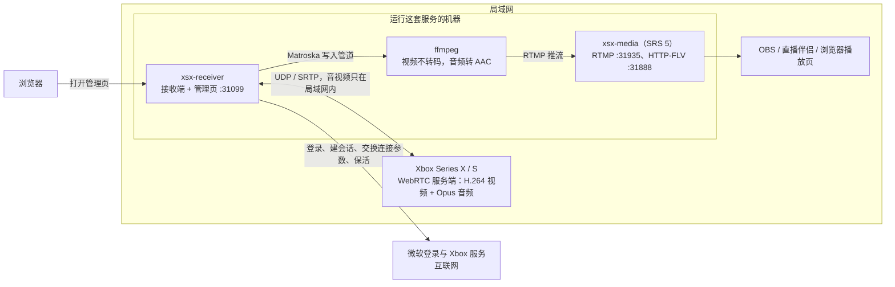
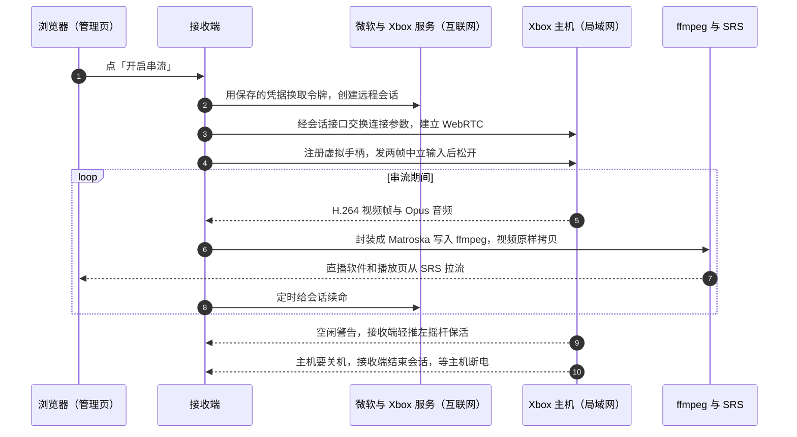

# XSX-Live: Xbox Series X/S 局域网原生画面串流与分发中枢

[](LICENSE)
[](docker-compose.yml)
[](receiver)
[](../../actions/workflows/build.yml)

[English](README.en.md) | **简体中文**

> **极低开销、视频零转码、2K 60fps 原画** 的 Xbox 局域网 WebRTC 接收器与流媒体中枢。
> 专为 OBS、抖音直播伴侣、局域网流媒体分发设计。

**项目简介**：把 Xbox Series X|S 的画面和声音接收到局域网内的 NAS 或电脑上，转成一路直播流，供抖音直播伴侣、OBS 等直播软件取用，也可以直接用浏览器观看。音视频只在局域网内传输，不影响在主机上用手柄正常游戏。

---

## 🌟 项目亮点

* **🚀 视频零转码（Stream Copy）**：Xbox 输出的 H.264 视频帧原样转封装，不解码、不重编码，**无画质损失，也不需要 GPU**。仅音频从 Opus 转为 AAC。
* **⚡ 轻量**：接收端基于 Rust（`str0m` WebRTC 协议栈），分发服务为 SRS 5。待机内存约 10 MB；串流时的占用与机器有关，原项目给出的参考值约为内存 40 MB、单核 CPU 15%。
* **🎛️ Web 管理页**：启停串流、断线重连、实时帧率/码率、静音预览。示例配置里的地址是 `http://<YOUR_HOST_IP>:31099/`。
* **🎬 多种拉流方式**：HTTP-FLV、RTMP，以及内置 `mpegts.js` 的浏览器播放页。
* **🔒 音视频只走局域网**：只有登录、建立会话和心跳走互联网；音视频在主机与接收端之间局域网直连，不经公网中继。
* **🎮 不占手柄**：接收端平时不发送手柄数据，不影响物理手柄。仅在建立连接时注册一次虚拟手柄，以及长时间无操作、主机即将断开会话时轻推摇杆。
* **🔐 管理页内登录微软账号**：无需脚本，也无需手动编辑凭据文件。
* **📦 开箱即用**：数据目录自动生成；主机关机时串流自动停止，可选择下次开机是否自动开始。
* **🌐 中英文界面**：管理页与播放页均支持中文和英文，管理页可随时切换。

---

## 📖 术语

下文反复出现的几个词：

| 术语 | 含义 |
| :--- | :--- |
| 镜像 | 包含程序及其运行环境的只读文件包，导入后即可运行。接收端镜像为 `xsx-live/receiver` |
| 容器 | 镜像的运行实例。本服务包含两个容器：接收端 `xsx-receiver` 和分发服务 `xsx-media` |
| compose 文件 | 描述要启动哪些容器及其配置的 YAML 文件：通用的 `docker-compose.yml`，或 [`compose/`](compose) 目录下按 NAS 品牌准备好的现成文件 |
| 接收端 | 连接 Xbox、接收音视频并推流给分发服务的程序，同时提供管理页 |
| 分发服务 | 接收推流，并向直播软件、播放页提供拉流的服务，使用 SRS |
| 管理页 | 启停串流、登录账号、查看状态的网页，示例配置里的地址是 `http://<YOUR_HOST_IP>:31099/` |
| 播放页 | 用浏览器直接观看画面的网页，示例配置里的地址是 `http://<YOUR_HOST_IP>:31888/xsx/index.html` |
| 推流 / 拉流 | 推流是发布音视频流，拉流是接收音视频流。接收端推流，直播软件和播放页拉流 |
| RTMP / HTTP-FLV | 两种流媒体传输协议，直播软件通常至少支持其中一种 |
| 转码 / 转封装 | 转码会重新编码，消耗 CPU 且可能有画质损失；转封装只改变封装格式，不重新编码 |
| 环境变量 | 传给程序的配置项，写在 compose 文件的 `environment:` 下，每项的含义在该文件中均有注释 |
| 数据目录 | 存放凭据、运行状态和播放页的目录，自动生成。通用 compose 文件下是文件旁的 `xsx-files/`，NAS 版固定为 `/share/ContainerStation/xsx-live/xsx-files` |
| 凭据 | 登录后保存的长期令牌，存于 `xsx-files/auth/session.json`，由接收端自动续期 |
| 镜像仓库 | 存放镜像的服务。`ghcr.io` 由 GitHub 运营，Docker Hub 由 Docker 运营 |
| Release | GitHub 上的发布页，每个版本一个，附有可导入的镜像包 |

地址中的 `<YOUR_HOST_IP>` 指运行这套服务的机器的局域网 IP。

---

## 📐 架构设计

整套服务由两个容器组成，用一份 compose 文件编排：

| 容器 | 内容 | 作用 |
| :--- | :--- | :--- |
| `xsx-receiver` | 接收端（Rust）+ ffmpeg | 登录微软账号、与 Xbox 建立远程会话、接收音视频并推流给分发服务，同时提供管理页 |
| `xsx-media` | SRS 5 | 接收 RTMP 推流，对外提供 HTTP-FLV、RTMP 拉流和浏览器播放页 |



### 工作原理



几个要点：

* **联网的很少**：互联网上只走登录、建会话，以及串流期间很小的心跳（给会话续命、查主机电源状态）。管理页用 OAuth 授权码加 PKCE 的方式登录微软账号，密码只在微软页面输入，长期凭据保存在 `xsx-files/auth/session.json`，之后接收端自动续期。建会话靠 Xbox 的远程串流接口（xHome）：接收端通过它创建会话，并和主机交换 WebRTC 的连接参数（ICE、SDP，即建立直连所需的地址和参数）。连接建好后，画面和声音在主机与接收端之间走局域网直连，不经过公网中继，所以延迟低，也不占外网带宽。
* **视频不转码**：接收端把收到的 H.264 视频帧原样封装成 Matroska 交给 ffmpeg，ffmpeg 用 `-c:v copy` 直接写进 RTMP，不解码也不重编码，所以不需要显卡。只有音频从 Opus 转成 AAC，因为直播软件普遍只认 AAC。
* **平时不碰手柄**：接收端不发任何手柄数据。只有两种情况会动一下：刚连上时「打个招呼」，免得被当成没有客户端踢掉；约 10 分钟没人碰手柄、主机要踢人时，轻推一下左摇杆。细节见下文「手柄与保活」。
* **关机会让串流自己停**：主机关机时会通知接收端，接收端结束会话并等主机彻底断电，不会把它重新连住。之后开不自动开始，由管理页的「开机自动串流」开关决定。
* **分发**：SRS 收到推流后同时提供三种拉流方式（HTTP-FLV、RTMP、浏览器播放页），直播软件和浏览器各取所需。

接收端的代码按职责分成几个模块（`receiver/src/`）：

| 模块 | 职责 |
| :--- | :--- |
| `main.rs` | 主循环：按开关状态建会话、收流、出错重试；空闲保活和关机处理 |
| `auth.rs`、`login.rs` | 凭据的保存与续期；管理页里的登录 |
| `xhome.rs` | 调用远程串流接口：登录、找主机、建会话、交换连接参数、保活 |
| `rtc/` | WebRTC 数据通道上的控制消息，以及手柄输入的编码 |
| `relay.rs` | 把音视频封装成 Matroska 喂给 ffmpeg |
| `dashboard.rs` | 管理页和接口，含访问来源校验 |
| `control.rs` | 串流开关和「开机自动串流」的保存 |
| `health.rs`、`logging.rs`、`assets.rs` | 状态文件、日志文件、播放页文件的安装 |

---

## 🚀 快速上手

开始之前确认：

* 一台 Xbox Series X|S，与运行这套服务的机器在**同一个局域网**内，并处于开机状态（接收端不会唤醒主机）。
* 一个微软账号，即 Xbox 主机上登录的账号。
* 机器上已安装 Docker 和 Docker Compose（NAS 的容器管理套件已包含），并且能访问微软的登录和服务。

[`compose/`](compose) 目录下按 NAS 品牌准备了现成的 compose 文件，复制一份、按文件里 `TODO` 标记改好，贴进 NAS 的容器管理界面即可。三种装法的区别只在接收端镜像从哪来。

### 方式 A：导入镜像包（NAS 推荐）

1. **下载镜像包**。到 [Releases](../../releases) 页面下载 `xsx-live-receiver-v1.0.1.tar.gz`，解压得到 `.tar`。
2. **导入镜像并创建应用**，按 NAS 品牌操作：
   * **QNAP（Container Station）**：复制 [`compose/qnap.yml`](compose/qnap.yml)。「映像」页点「导入」，选中解压出的 `.tar`；把文件里标 `TODO` 的地方改成自己的（只有主机地址一处）；「应用程序」页点「创建」，贴入文件内容，创建并启动。
   * **群晖（Container Manager，DSM 7.2 及以上）**：复制 [`compose/synology.yml`](compose/synology.yml)。「映像」页点「新增」→「从文件添加」，选中解压出的 `.tar`；「项目」页点「新增」，路径选一个存放数据的文件夹，选「创建 docker-compose.yml」，贴入改好的文件内容，一路下一步直到完成。
3. **登录并开始**。浏览器打开 `http://<NAS 的 IP>:31099/`，在「Xbox 账号」中登录（见下文「登录 Xbox 账号」），然后点「开启串流」。

### 方式 B：从镜像仓库拉取

不需要下载和导入镜像包，NAS 能访问 `ghcr.io`（GitHub 运营的镜像仓库）即可，创建应用时自动拉取镜像。每个版本发布后都会自动发布到这里。

1. 复制对应品牌的拉取版文件：QNAP 用 [`compose/qnap-pull.yml`](compose/qnap-pull.yml)，群晖用 [`compose/synology-pull.yml`](compose/synology-pull.yml)。
2. 把文件里标 `TODO` 的地方改成自己的（只有主机地址一处）。镜像地址已经写好，指向本仓库在 ghcr.io 上发布的镜像。
3. 按方式 A 中对应品牌的步骤创建应用（跳过导入镜像）。

镜像包默认是私有的，仓库所有者需先在 GitHub 的 Packages 页面将其改为公开（此后不能再改回私有），其他用户才能拉取。

### 方式 C：本机编译

适合需要修改代码的情况。点击仓库页面的「Code」按钮复制克隆地址：

```bash
git clone <克隆地址>
cd xsx-live
cp .env.example .env
```

执行 `docker compose up -d` 时会自动编译接收端，首次需要几分钟。配置项在 `.env` 中修改，见下面的「配置」。

### 配置

NAS 用的文件里，通常只需要改 `TODO` 标出的那一处：

| 配置项 | 改成什么 | 原因 |
| :--- | :--- | :--- |
| `XBOX_IP` | Xbox 主机的局域网 IP | 可以**不填**：不填时接收端在建立连接时直接采用微软推来的主机候选地址（`XBOX_IP` 填了就以它为准）。填写时必须填对，建议给主机设置固定 IP |

其余配置都有可用的默认值，其中两个值得知道：

* `MEDIA_HTTP_BASE`：保持默认 `http://127.0.0.1:31888` 即可（1.0.1 起）。管理页会自动用你访问它时所用的 IP 生成播放地址和拉流地址。端口与分发服务的 HTTP 端口保持一致（示例配置里是 31888）。
* 端口、时区等其余选项见下文「环境变量说明」，每一项的含义也写在 compose 文件的注释里。

### 启动之后

* 无需提前准备任何文件：数据目录会在首次启动时自动生成，内容见下文「数据目录」。
* 管理页和播放页均打包在镜像内。
* 查看运行状态：

```bash
docker compose ps
docker compose logs -f receiver
```

* 日志同时写入数据目录的 `state/receiver.log`，每行带本地时间。
* 升级到新版本的方法见下文「更新版本」。

---

## 🔐 登录 Xbox 账号

Xbox 远程串流需要微软账号授权。打开管理页，在「Xbox 账号」面板里点「开始登录」，用 **Xbox 主机上登录的那个账号** 登录并同意授权即可。

浏览器随后会跳到 `http://localhost/?code=...` 并提示“无法访问此网站”，这是正常的：把地址栏里的完整网址复制，粘贴回管理页，点「完成登录」。

凭据保存在 `xsx-files/auth/session.json`，之后由接收端自动续期，只有凭据失效时才需要重新登录。登录后点「开启串流」就会连接主机。

几点说明：

* 点「开始登录」后要在 **10 分钟内** 完成，超时了回到管理页重新点一次。
* 凭据还有效时，管理页不允许再登录。这是为了防止局域网里的其他设备把你正在用的凭据覆盖掉。
* 默认用的是开源项目 kite 登记的微软应用，不需要自己配置。想用自己的微软应用，见下文「环境变量说明」里的 `XBOX_CLIENT_ID`。

---

## 🏗 自动构建

仓库带一个 GitHub Actions 工作流（`.github/workflows/build.yml`）：推送 `v` 开头的标签，或在 Actions 页面手动运行并填入版本号，GitHub 会在其服务器上运行测试、编译镜像并发布：

* 镜像：`ghcr.io/hizml/xsx-live-receiver:<版本>` 和 `:latest`
* 压缩的镜像包 `xsx-live-receiver-<版本>.tar.gz`（打标签时挂在 Release 上，手动运行时是构建产物），导入前要先解压
* 分发服务的镜像：把 SRS 官方镜像按固定摘要复制到 `ghcr.io/hizml/xsx-live-media:5`（官方在 Docker Hub，国内常拉不到）

构建状态和每次的产物在仓库的 [Actions](../../actions/workflows/build.yml) 页面。测试先跑：单元测试和两个用真实 ffmpeg 的端到端测试都通过，才会编译镜像；标签和 `receiver/Cargo.toml` 里的版本号不一致时直接失败。

## 🏷 版本号

版本号写在 `receiver/Cargo.toml` 里，编进程序。发布一版的步骤：

1. 改 `receiver/Cargo.toml` 里的 `version`（例如 `1.1.0`）。
2. 提交后打同名的标签并推送：`git tag v1.1.0 && git push origin v1.1.0`。
3. GitHub Actions 会检查标签和 `version` 是否一致，一致才编译、发布镜像和镜像包。

在哪里能看到当前跑的是哪一版：

* 管理页页脚（「接收端 vX.Y.Z」；显示「版本过旧」说明镜像还没换）。
* 状态接口 `GET /api/status` 的 `version` 字段。
* 日志 `xsx-files/state/receiver.log` 的第一行 `VERSION version=…`。
* `docker exec xsx-receiver /usr/local/bin/xsx-native --version`。
* 镜像标签 `org.opencontainers.image.version`。

---

## 🖥️ 管理面板与使用

打开浏览器访问管理页面：
`http://<YOUR_HOST_IP>:31099/`

* **开启串流**：连接已开机的 Xbox，接收画面并推送到流媒体分发服务。
* **停止串流**：结束当前接收会话、停止本地推流，并暂停自动重连。
* **重新连接**：快速重启会话，不重启整个服务。
* **实时监控**：可查看实时分辨率（最高 2560×1440）、实时帧率、码率及已串流时长。
* **画面预览**：按需开启低延迟静音画面预览。
* **Xbox 账号**：登录微软账号；凭据有效时不允许重复登录，避免被局域网里的其他设备覆盖。
* **开机自动串流**：主机关机时串流会停止。开关打开时，下次开机自动开始串流；关闭时需要手动点「开启串流」。
* **语言**：页头右上角可以在「中文 / EN」之间切换，详见下文「多语言」。

管理页只接受用「IP 加端口」或「localhost 加端口」访问，例如 `http://192.168.1.10:31099/`，本机访问用 `http://localhost:31099/` 或 `http://127.0.0.1:31099/`。其他域名会返回 403。这是为了防「DNS 重绑定」：公网上的一个网站可以把自己的域名解析到你的局域网 IP 上，让你的浏览器替它访问这台机器上的管理页和接口。`localhost` 是浏览器固定指向本机的名字，攻击者控制不了，所以放行。

> 手柄与保活：接收端平时不发送任何手柄数据。开机握手时会向主机「打一次招呼」（注册虚拟手柄、发两帧中立输入后立即松开），避免会话因「没有客户端」被踢；约 10 分钟没人碰手柄时，主机会发空闲警告并在 120 秒后断开，此时接收端会把左摇杆轻推到 12.5%、40 毫秒后回中（与微软官方网页客户端的做法相同），**每轮警告只推这一次**。挂机期间约每 10 分钟一轮，每轮主机画面上会出现一次「某某 正在远程游戏」。把 `IDLE_KEEPALIVE` 设为 `0` 可以关掉，代价是长时间不操作会被主机断开。

---

## 🌐 多语言

管理页和播放页都有中文、英文两种文字。

* **管理页**：页头右上角可以在「中文 / EN」之间切换。语言按这个顺序决定：网址里的 `?lang=en` 或 `?lang=zh`（例如 `http://<YOUR_HOST_IP>:31099/?lang=en`）、上次在这个浏览器里选的、浏览器自己的语言（不是中文的一律显示英文）。接口的报错带着固定的代码，页面按代码翻译成当前语言。
* **播放页**：按浏览器语言显示，也可以用 `?lang=` 指定；从管理页打开时会带上管理页当前的语言。
* **登录跳回页**：按浏览器的语言显示。

要加第三种语言，改三处文字表即可：`dashboard/i18n.js`（管理页）、`www/index.html` 里的 `TEXT`（播放页）、`receiver/src/dashboard.rs` 里的 `TEXTS`（接口报错和跳回页）。单元测试会核对页面和脚本里用到的每一个文字键在两种语言里都有说明。

---

## 📺 OBS 与直播伴侣接入

在 **抖音直播伴侣** 或 **OBS Studio** 中添加来源：

1. **方式一：浏览器来源（推荐）**
   * URL: `http://<YOUR_HOST_IP>:31888/xsx/index.html`
   * 分辨率：`1920x1080` 或 `2560x1440` (16:9)
   * 勾选“控制此来源的音频”（如需推游戏原声）。播放页默认静音，要默认带声音，在地址后面加 `?audio=1`
2. **方式二：网络媒体源 / HTTP-FLV**
   * URL: `http://<YOUR_HOST_IP>:31888/live/xsx.flv`
3. **方式三：RTMP 拉流**
   * URL: `rtmp://<YOUR_HOST_IP>:31935/live/xsx`

---

## ⚙️ 环境变量说明

通常只需要改标了 ★ 的一项，其余都有可用的默认值。分发服务的 `SRS_*` 变量是为低延迟做的调校，平时不用动，每一项的含义写在 [`docker-compose.yml`](docker-compose.yml) 的注释里。

| 变量名 | 默认值 | 描述 |
| :--- | :--- | :--- |
| ★ `XBOX_IP` | `192.168.1.180` | Xbox 主机的局域网 IP，填写时必须填对，建议给主机设固定 IP。也可以不填：接收端会直接采用微软推来的主机候选地址 |
| `BIND_IP` | `0.0.0.0` | SRS 端口在宿主机的监听绑定 IP |
| `DASHBOARD_BIND` | `0.0.0.0:31099` | 管理页面监听 IP 与端口。写成 `0.0.0.0` 即可用本机任意 IP 访问 |
| `MEDIA_HTTP_BASE` | `http://127.0.0.1:31888` | 别的设备访问分发服务用的地址。保持默认即可（1.0.1 起）：管理页自动用访问它时所用的 IP 生成播放和拉流地址。端口与分发服务的 HTTP 端口保持一致（示例配置里是 31888） |
| `OUTPUT_RTMP` | `rtmp://127.0.0.1:31935/live/xsx` | 接收器推流至 SRS 的目标 RTMP 地址 |
| `XBOX_AUTH_FILE` | `/files/auth/session.json` | 容器内认证凭据文件路径 |
| `STATE_DIR` | `/files/state` | 容器内状态与控制文件落盘目录，日志 `receiver.log` 也写在这里 |
| `WWW_DIR` | `/files/www` | 播放页的输出目录，启动时自动写入；不设则不写 |
| `DASHBOARD_DIR` | 不设 | 设置后管理页改从这个目录读，方便改页面时不重新编译 |
| `TZ` | `Asia/Shanghai` | 日志用的时区 |
| `IDLE_KEEPALIVE` | `1` | 空闲警告后是否轻推摇杆保活，`0` 关闭 |
| `XBOX_CLIENT_ID` | 内置 | 管理页登录用的微软应用 ID。不设则用内置的，它来自开源项目 kite |
| `AUTH_REDIRECT_URI` | 不设 | 登录后的跳回地址，必须以 `https://` 开头并已在应用里登记；不设则按粘贴网址的方式登录 |
| `XBOX_SERVER_ID` | 不设 | 账号下有多台主机时，指定要串流的那一台 |
| `XSX_IMAGE` | `xsx-live/receiver:latest` | 接收端镜像。想用 GitHub 上发布的镜像，设成 `ghcr.io/hizml/xsx-live-receiver:<版本>` 后 `docker compose pull` |

---

## 📁 数据目录

`xsx-files/` 在第一次启动时自动生成，三种装法用的都是同一个目录：

```text
xsx-files/
├── auth/
│   └── session.json       微软账号凭据。管理页登录后生成，接收端自动续期。不要外传
├── state/
│   ├── control.json       串流开关和「开机自动串流」的当前状态
│   ├── status.json        接收端的当前状态，管理页读它
│   ├── receiver.log       接收端日志，超过 20MB 时转存为 receiver.previous.log
│   └── ffmpeg.log         ffmpeg 的输出，建立会话后才有
└── www/                   播放页（index.html 和它用的库），启动时自动写入，分发服务从这里读
```

备份或迁移时带上 `auth/` 和 `state/control.json` 就够了：前者省得重新登录，后者保留开关设置。其余文件都会自动再生成。

---

## 🔄 更新版本

数据都在 `xsx-files/` 里，换版本不会动它，登录和开关设置都保留。

1. 拿到新版本的镜像。拉取版 compose（`*-pull.yml`）带了 `pull_policy: always`，直接重建应用就会拉取新版本；命令行下执行 `docker compose pull`。导入镜像包的方式要注意：NAS 的「重建」默认**不会**重新拉取或识别新导入的同名镜像，先在「映像」页删掉旧的 `xsx-live/receiver` 再导入新的并重建。
2. 重建应用：Container Station 里对应用程序点「重建」（或编辑后重新套用）；命令行在 compose 文件所在目录执行 `docker compose up -d`。
3. 打开管理页，页脚显示新的版本号就是换好了。显示「版本过旧」说明还在用旧镜像。

想退回旧版本，导入旧版本的镜像包再重建一次即可，数据目录不用动。

---

## ❓ 常见问题

* **打开管理页是 403**：管理页只接受 IP 或 `localhost` 访问，端口要和 `DASHBOARD_BIND` 一致，例如 `http://192.168.1.10:31099/`。用其他域名访问，或者端口对不上，都会返回 403。

* **状态一直是「等待 XSX 开机」**：接收端不会唤醒主机。把主机开机后会自动连上，日志里对应的原因是 `CONSOLE_OFFLINE`。

* **登录后浏览器显示「无法访问此网站」**：这是正常的。微软登录完成后会跳到本机的 `http://localhost/?code=...`，把地址栏里的完整网址复制，粘贴回管理页，点「完成登录」。

* **提示「登录已过期」或「登录校验失败」**：点「开始登录」后要在 10 分钟内完成，而且要用这一次登录对应的跳转网址。回到管理页重新点「开始登录」再来一遍。

* **新打开的播放页要等两三秒才出画面**：分发服务为了低延迟关掉了关键帧缓存，新观众要等到下一个关键帧。想一打开就有画面（代价是延迟变大），把 `docker-compose.yml` 里的 `SRS_VHOST_PLAY_GOP_CACHE` 改成 `on`。

* **播放页没有声音**：播放页默认静音。鼠标或手指动一下，点右下角的「声音」。要让直播软件里的浏览器来源默认带声音，在地址后面加 `?audio=1`。

* **长时间不动手柄后串流断了**：默认不会这样，主机遇警时接收端会轻推摇杆保住会话。如果把 `IDLE_KEEPALIVE` 设成了 `0`，约 12 分钟不动手柄就会被主机断开，这是主机的规则。

* **串流中途断开**：接收端会自动重连，不用操作。日志在 `xsx-files/state/receiver.log`，每一行带时间。其中的 `VIDEO_SPS_CHANGED` 表示主机调整了编码参数，接收端已经接着写下去，不是故障。

* **主机关机后串流停了**：这是预期行为：主机关机时接收端会结束会话，不去打扰它关机。下次开机是否自动开始，看管理页的「开机自动串流」开关。

* **创建应用时 media 的镜像拉不下来**：compose 里默认用本仓库复制到 ghcr.io 的那份（`ghcr.io/hizml/xsx-live-media:5`），不需要访问 Docker Hub。仍想用官方地址的话，把 `image:` 换回 `ossrs/srs:5`（在 Docker Hub 上，国内可能拉不到，可给 Docker 配置镜像加速器）。
* **怎么确认跑的是哪一版**：看管理页页脚，或者日志第一行的 `VERSION version=…`，见上文「版本号」。

---

## 🗂 仓库结构

```text
.
├── receiver/              接收端（Rust）
│   ├── Cargo.toml         版本号写在这里
│   ├── Dockerfile         GitHub Actions 和本机编译用的构建文件
│   └── src/               源码，各模块的职责见上文「架构设计」
├── dashboard/             管理页的静态文件：index.html、app.js、i18n.js、style.css
├── www/                   播放页：index.html 和它用的 mpegts.js
├── docker-compose.yml     通用的示例配置（本机编译用），每一项都有注释
├── compose/                给 NAS 准备好的配置，按品牌和装法分四份，只需修改 TODO 标出的地方
├── .env.example           环境变量示例
├── srs.conf               分发服务的参考配置，和 compose 里的 SRS_* 变量等价
└── .github/workflows/     GitHub Actions：测试、编译镜像、发布
```

---

## 🛡️ 安全注意事项

这套服务是为**可信的局域网**设计的，没有账号和密码：

* **管理页没有密码**：局域网里的任何设备都能打开管理页、开关串流。管理页只接受用 IP 访问，挡的是别的网站冒充，挡不住局域网里的人。
* **拉流和推流没有鉴权**：局域网里的任何设备都能看画面；接收端没在推流时，别的设备也可以往同一个流名推流。
* **凭据文件**：`xsx-files/` 里的 `auth/session.json` 是你的微软账号凭据，**不要上传到公开代码库，也不要分享给别人**。`.gitignore` 和 `.dockerignore` 已经忽略整个目录。

所以请只在可信的局域网里使用，**不要把 31099、31888、31935 这些端口直接映射到公网**。

---

## 📄 License

本项目采用 MIT 许可证，全文见根目录的 [LICENSE](LICENSE)（和随接收端代码附带的 `receiver/LICENSE.upstream` 是同一份）。协议逆向与信令实现参考了社区优秀的开源项目（如 `DRHATL95/kite` 与 `unknownskl/xbox-xcloud-player`），在此深表感谢。播放页用到的 `mpegts.js` 也是 MIT 许可证，随文件一起分发（`www/vendor/LICENSE`）。分发服务使用的 SRS 同样是 MIT 许可证，ghcr 里那份是官方镜像按摘要的原样复制。
