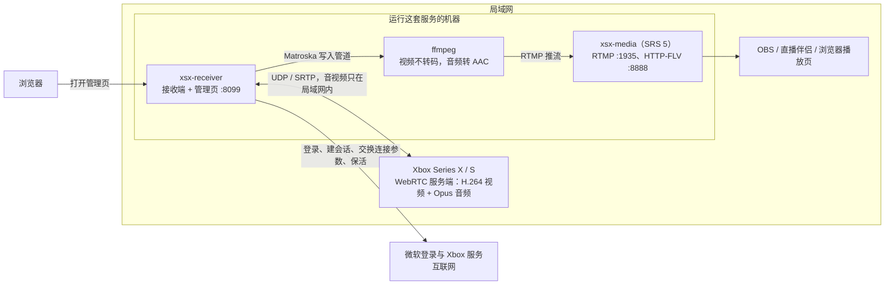
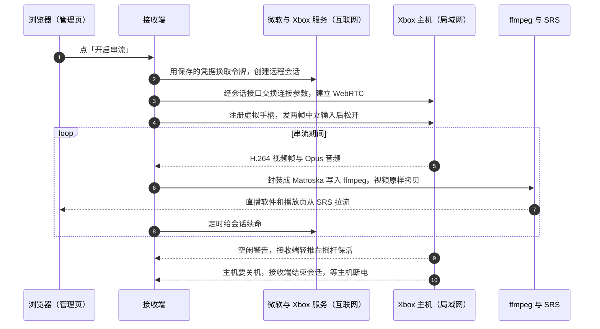

# XSX-Live: Xbox Series X/S 局域网原生画面串流与分发中枢

[English](README.en.md) | **简体中文**

> **极低开销、视频零转码、2K 60fps 原画** 的 Xbox 局域网 WebRTC 接收器与流媒体中枢。
> 专为 OBS、抖音直播伴侣、局域网流媒体分发设计。

---

## 🌟 项目亮点

* **🚀 视频零转码（Stream Copy）**：直接从 Xbox WebRTC 媒体流取出 H.264 视频帧原样转封装，**不解码、不重编码、没有画质损失**，也不需要显卡。只有音频从 Opus 转成 AAC。
* **⚡ 很轻量**：接收端用 Rust 写成（基于 `str0m` WebRTC 协议栈），分发服务是 SRS 5。待机内存约 10 MB；串流时的占用取决于机器，原项目给的参考值是内存约 40 MB、单核 CPU 约 15%。
* **🎛️ 现代化 Web 控制面板**：提供直观的 Web 管理界面（默认端口 `8099`），支持一键启停串流、断线重连、实时帧率/码率监控与静音画面预览。
* **🎬 丰富的播放与拉流协议**：同时支持 HTTP-FLV、RTMP、以及集成自托管 `mpegts.js` 的低延迟浏览器播放页。
* **🔒 音视频只走局域网**：登录、建会话和少量心跳走互联网；音视频在主机和接收端之间局域网直连，不经过公网中继。
* **🎮 不占手柄**：接收端平时不发送任何手柄数据，不影响在主机上用物理手柄玩游戏。只有刚连上时「打个招呼」，以及长时间没人操作、主机要结束会话时，才会动一下摇杆。
* **🔐 管理页内登录微软账号**：不需要任何脚本或手工编辑凭据文件。
* **📦 开箱即用**：数据目录自动生成，装好就能用；主机关机时串流自动停止，可选下次开机是否自动开始。
* **🌐 中英文界面**：管理页和播放页都有中文、英文两种文字，管理页可以随时切换。

---

## 📐 架构设计

整套服务由两个容器组成，用一份 `docker-compose.yml` 编排：

| 容器 | 内容 | 作用 |
| :--- | :--- | :--- |
| `xsx-receiver` | 接收端（Rust）+ ffmpeg | 登录微软账号、与 Xbox 建立远程会话、接收音视频并推流给分发服务，同时提供管理页 |
| `xsx-media` | SRS 5 | 接收 RTMP 推流，对外提供 HTTP-FLV、RTMP 拉流和浏览器播放页 |

### 工作原理

几个要点：

* **联网的很少**：互联网上只走登录、建会话，以及串流期间很小的心跳（给会话续命、查主机电源状态）。管理页用授权码加 PKCE 的方式登录微软账号，长期凭据保存在 `xsx-files/auth/session.json`，之后接收端自动续期。建会话靠 Xbox 的远程串流接口（xHome）：接收端通过它创建会话，并和主机交换 WebRTC 的连接参数（ICE、SDP）。连接建好后，画面和声音在主机与接收端之间走局域网直连，不经过公网中继，所以延迟低，也不占外网带宽。
* **视频不转码**：接收端把收到的 H.264 视频帧原样封装成 Matroska 交给 ffmpeg，ffmpeg 用 `-c:v copy` 直接写进 RTMP，不解码也不重编码，所以不需要显卡。只有音频从 Opus 转成 AAC，因为直播软件普遍只认 AAC。
* **平时不碰手柄**：接收端不发任何手柄数据。只有两种情况会动一下：刚连上时「打个招呼」，免得被当成没有客户端踢掉；约 10 分钟没人碰手柄、主机要踢人时，轻推一下左摇杆。细节见下文「手柄与保活」。
* **关机会让串流自己停**：主机关机时会通知接收端，接收端结束会话并等主机彻底断电，不会把它重新连住。之后开不自动开始，由管理页的「开机自动串流」开关决定。
* **分发**：SRS 收到推流后同时提供三种拉流方式（HTTP-FLV、RTMP、浏览器播放页），直播软件和浏览器各取所需。

接收端的代码按职责分成几个模块（`receiver/src/`）：

| 模块 | 职责 |
| :--- | :--- |
| `main.rs` | 主循环：按开关状态建会话、收流、出错重试；空闲保活和关机处理 |
| `auth.rs`、`login.rs` | 凭据的保存与续期；管理页里的登录 |
| `xhome.rs` | 调用远程串流接口：登录、找主机、建会话、交换连接参数、保活 |
| `rtc/` | WebRTC 数据通道上的控制消息，以及手柄输入的编码 |
| `relay.rs` | 把音视频封装成 Matroska 喂给 ffmpeg |
| `dashboard.rs` | 管理页和接口，含访问来源校验 |
| `control.rs` | 串流开关和「开机自动串流」的保存 |
| `health.rs`、`logging.rs`、`assets.rs` | 状态文件、日志文件、播放页文件的安装 |

---

## 🚀 快速上手

1. **拿镜像**：到 [Releases](../../releases) 下载镜像包，解压后导入。Container Station 在「映像」页导入；命令行是 `docker load -i xsx-live-receiver-v1.0.0.tar`。
2. **改两个地址**：下载仓库里的 [`docker-compose.yml`](docker-compose.yml)，把 `XBOX_IP` 改成 Xbox 主机的局域网 IP，把 `MEDIA_HTTP_BASE` 里的 `127.0.0.1` 改成这台机器的局域网 IP。用命令行安装的话，把 [`.env.example`](.env.example) 复制成 `.env` 来改这两个值，compose 文件不用动。
3. **启动**：用这份 `docker-compose.yml` 创建应用。Container Station 里是新建应用程序，把内容贴进去，并把两处 `./xsx-files` 换成一个绝对路径（例如 `/share/ContainerStation/xsx-live/xsx-files`）；命令行是在文件所在目录执行 `docker compose up -d`。
4. **登录并开始**：浏览器打开 `http://<YOUR_HOST_IP>:8099/`，在「Xbox 账号」里登录，然后点「开启串流」。

不需要提前准备任何文件：数据目录 `xsx-files/` 会自动生成，管理页和播放页都在镜像里。运行状态用 `docker compose ps` 和 `docker compose logs -f receiver` 看，日志同时写在 `xsx-files/state/receiver.log`，每一行带本地时间。

另外两种装法只是镜像的来源不同，从第 2 步起都一样：

| 装法 | 怎么做 |
| :--- | :--- |
| 从镜像仓库拉取 | 把 `XSX_IMAGE` 设为 `ghcr.io/<账号>/xsx-live-receiver:<版本>`，再执行 `docker compose pull`。镜像包默认是私有的，仓库所有者要先在 GitHub 的 Packages 页面改成公开（改过之后不能再改回私有） |
| 本机编译 | 克隆仓库后直接 `docker compose up -d`，第一次会编译接收端，需要几分钟 |

---

### 登录 Xbox 账号

Xbox 远程串流需要微软账号授权。打开管理页，在「Xbox 账号」面板里点「开始登录」，用 **Xbox 主机上登录的那个账号** 登录并同意授权即可。

浏览器随后会跳到 `http://localhost/?code=...` 并提示“无法访问此网站”，这是正常的：把地址栏里的完整网址复制，粘贴回管理页，点「完成登录」。

凭据保存在 `xsx-files/auth/session.json`，之后由接收端自动续期，只有凭据失效时才需要重新登录。登录后点「开启串流」就会连接主机。

---

### 自动构建

仓库带一个 GitHub Actions 工作流（`.github/workflows/build.yml`）：推送 `v` 开头的标签，或者在 Actions 页面手动运行并填版本号，就会在 GitHub 上跑测试、编译镜像并发布：

* 镜像：`ghcr.io/<账号>/xsx-live-receiver:<版本>` 和 `:latest`
* 压缩的镜像包 `xsx-live-receiver-<版本>.tar.gz`（打标签时挂在 Release 上，手动运行时是构建产物），导入前要先解压

构建状态和每次的产物在仓库的 [Actions](../../actions/workflows/build.yml) 页面。测试先跑：单元测试和两个用真实 ffmpeg 的端到端测试都通过，才会编译镜像；标签和 `receiver/Cargo.toml` 里的版本号不一致时直接失败。

### 版本号

版本号写在 `receiver/Cargo.toml` 里，编进程序。发布一版的步骤：

1. 改 `receiver/Cargo.toml` 里的 `version`（例如 `1.1.0`）。
2. 提交后打同名的标签并推送：`git tag v1.1.0 && git push origin v1.1.0`。
3. GitHub Actions 会检查标签和 `version` 是否一致，一致才编译、发布镜像和镜像包。

在哪里能看到当前跑的是哪一版：

* 管理页页脚（「接收端 vX.Y.Z」；显示「版本过旧」说明镜像还没换）。
* 状态接口 `GET /api/status` 的 `version` 字段。
* 日志 `xsx-files/state/receiver.log` 的第一行 `VERSION version=…`。
* `docker exec xsx-receiver /usr/local/bin/xsx-native --version`。
* 镜像标签 `org.opencontainers.image.version`。

---

## 🖥️ 管理面板与使用

打开浏览器访问管理页面：
`http://<YOUR_HOST_IP>:8099/`

* **开启串流**：连接已开机的 Xbox，接收画面并推送到流媒体分发服务。
* **停止串流**：结束当前接收会话、停止本地推流，并暂停自动重连。
* **重新连接**：快速重启会话，不重启整个服务。
* **实时监控**：可查看实时分辨率（最高 2560×1440）、实时帧率、码率及已串流时长。
* **画面预览**：按需开启低延迟静音画面预览。
* **Xbox 账号**：登录微软账号；凭据有效时不允许重复登录，避免被局域网里的其他设备覆盖。
* **开机自动串流**：主机关机时串流会停止。开关打开时，下次开机自动开始串流；关闭时需要手动点「开启串流」。
* **语言**：页头右上角可以在「中文 / EN」之间切换，详见下文「多语言」。

管理页只接受用 IP 访问（例如 `http://192.168.1.10:8099/`），用域名访问会返回 403，这是为了防止别的网站把自己的域名解析到这台机器上冒充管理页。

> 手柄与保活：接收端平时不发送任何手柄数据。开机握手时会向主机「打一次招呼」（注册虚拟手柄、发两帧中立输入后立即松开），避免会话因「没有客户端」被踢；约 10 分钟没人碰手柄时，主机会发空闲警告并在 120 秒后断开，此时接收端会把左摇杆轻推到 12.5%、40 毫秒后回中（与微软官方网页客户端的做法相同），半分钟后再推一次作为保险。每推一次，主机画面上会出现一次「某某 正在远程游戏」。把 `IDLE_KEEPALIVE` 设为 `0` 可以关掉，代价是长时间不操作会被主机断开。

---

## 🌐 多语言

管理页和播放页都有中文、英文两种文字。

* **管理页**：页头右上角可以在「中文 / EN」之间切换。语言按这个顺序决定：网址里的 `?lang=en` 或 `?lang=zh`（例如 `http://<YOUR_HOST_IP>:8099/?lang=en`）、上次在这个浏览器里选的、浏览器自己的语言（不是中文的一律显示英文）。接口的报错带着固定的代码，页面按代码翻译成当前语言。
* **播放页**：按浏览器语言显示，也可以用 `?lang=` 指定；从管理页打开时会带上管理页当前的语言。
* **登录跳回页**：按浏览器的语言显示。

要加第三种语言，改三处文字表即可：`dashboard/i18n.js`（管理页）、`www/index.html` 里的 `TEXT`（播放页）、`receiver/src/dashboard.rs` 里的 `TEXTS`（接口报错和跳回页）。单元测试会核对页面和脚本里用到的每一个文字键在两种语言里都有说明。

---

## 📺 OBS 与直播伴侣接入

在 **抖音直播伴侣** 或 **OBS Studio** 中添加来源：

1. **方式一：浏览器来源（推荐）**
   * URL: `http://<YOUR_HOST_IP>:8888/xsx/index.html`
   * 分辨率：`1920x1080` 或 `2560x1440` (16:9)
   * 勾选“控制此来源的音频”（如需推游戏原声）。播放页默认静音，要默认带声音，在地址后面加 `?audio=1`
2. **方式二：网络媒体源 / HTTP-FLV**
   * URL: `http://<YOUR_HOST_IP>:8888/live/xsx.flv`
3. **方式三：RTMP 拉流**
   * URL: `rtmp://<YOUR_HOST_IP>:1935/live/xsx`

---

## ⚙️ 环境变量说明

| 变量名 | 默认值 | 描述 |
| :--- | :--- | :--- |
| `XBOX_IP` | `192.168.1.180` | Xbox 主机的局域网 IP，**必须填对**。接收端只和这个地址收发音视频，建议给主机设固定 IP |
| `BIND_IP` | `0.0.0.0` | SRS 端口在宿主机的监听绑定 IP |
| `DASHBOARD_BIND` | `0.0.0.0:8099` | 管理页面监听 IP 与端口。写成 `0.0.0.0` 即可用本机任意 IP 访问 |
| `MEDIA_HTTP_BASE` | `http://127.0.0.1:8888` | 别的设备访问分发服务用的地址，管理页用它拼出播放地址和拉流地址。要写成这台机器的局域网 IP |
| `OUTPUT_RTMP` | `rtmp://127.0.0.1:1935/live/xsx` | 接收器推流至 SRS 的目标 RTMP 地址 |
| `XBOX_AUTH_FILE` | `/files/auth/session.json` | 容器内认证凭据文件路径 |
| `STATE_DIR` | `/files/state` | 容器内状态与控制文件落盘目录，日志 `receiver.log` 也写在这里 |
| `WWW_DIR` | `/files/www` | 播放页的输出目录，启动时自动写入；不设则不写 |
| `DASHBOARD_DIR` | 不设 | 设置后管理页改从这个目录读，方便改页面时不重新编译 |
| `TZ` | `Asia/Shanghai` | 日志用的时区 |
| `IDLE_KEEPALIVE` | `1` | 空闲警告后是否轻推摇杆保活，`0` 关闭 |
| `XBOX_CLIENT_ID` | 内置 | 管理页登录用的微软应用 ID。不设则用内置的，它来自开源项目 kite |
| `AUTH_REDIRECT_URI` | 不设 | 登录后的跳回地址，必须以 `https://` 开头并已在应用里登记；不设则按粘贴网址的方式登录 |
| `XBOX_SERVER_ID` | 不设 | 账号下有多台主机时，指定要串流的那一台 |
| `XSX_IMAGE` | `xsx-live/receiver:latest` | 接收端镜像。想用 GitHub 上发布的镜像，见 `.env.example` 里的说明 |

---

## 🛡️ 安全注意事项

这套服务是为**可信的局域网**设计的，没有账号和密码：

* **管理页没有密码**：局域网里的任何设备都能打开管理页、开关串流。管理页只接受用 IP 访问，挡的是别的网站冒充，挡不住局域网里的人。
* **拉流和推流没有鉴权**：局域网里的任何设备都能看画面；接收端没在推流时，别的设备也可以往同一个流名推流。
* **凭据文件**：`xsx-files/` 里的 `auth/session.json` 是你的微软账号凭据，**不要上传到公开代码库，也不要分享给别人**。`.gitignore` 和 `.dockerignore` 已经忽略整个目录。

所以请只在可信的局域网里使用，**不要把 8099、8888、1935 这些端口直接映射到公网**。

---

## 📄 License

接收端采用 MIT 许可证，全文见 [`receiver/LICENSE.upstream`](receiver/LICENSE.upstream)。协议逆向与信令实现参考了社区优秀的开源项目（如 `DRHATL95/kite` 与 `unknownskl/xbox-xcloud-player`），在此深表感谢。播放页用到的 `mpegts.js` 也是 MIT 许可证，随文件一起分发（`www/vendor/LICENSE`）。
